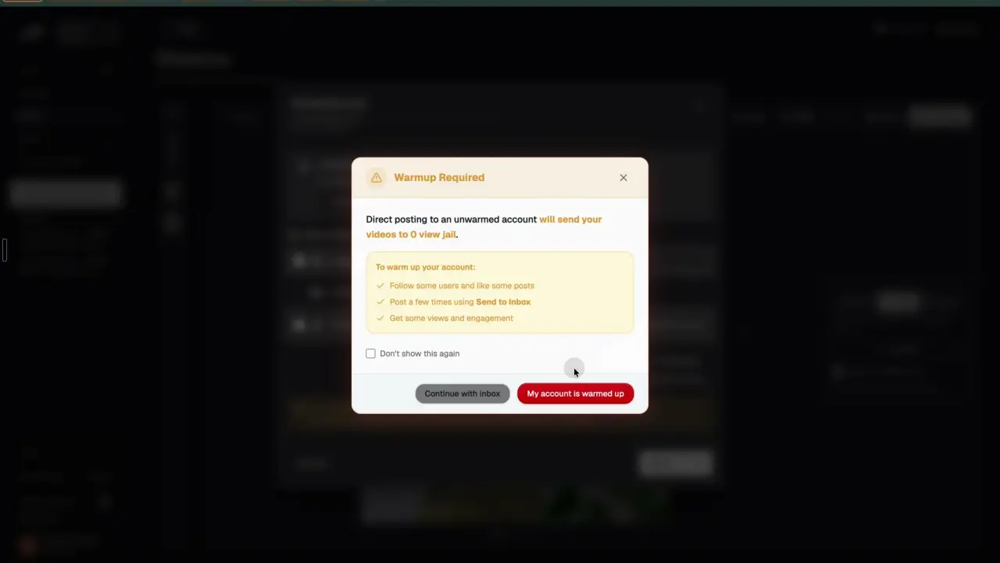
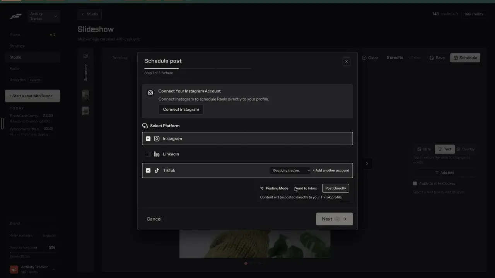

# TikTok inbox and new-account care

`publish-tiktok` | publish | phase 7 | status: partial | /north-star#publish-tiktok

## Leo asked

No direct ask; from the competitor research.

## How the best do it

Fastlane puts a "Posting Mode" under the TikTok row of its schedule modal, with two toggle buttons, "Send to Inbox" (the default) and "Post Directly" (notes-2.md F14).

- Send to Inbox helper: "Content will be sent to your TikTok inbox for review before posting." Below it an orange notice with an inbox icon: "After it's scheduled, open the TikTok app -> Inbox -> System notifications and tap your post to finish publishing. Any caption you add here carries into the draft. Review and finish posting in the TikTok app."
- Post Directly helper: "Content will be posted directly to your TikTok profile." The orange notice goes away.


Choosing "Post Directly" opens a guard modal, "Warmup Required" (notes-2.md F15): "Direct posting to an unwarmed account will send your videos to 0 view jail." A yellow box, "To warm up your account:", lists "Follow some users and like some posts", "Post a few times using Send to Inbox", "Get some views and engagement". A checkbox "Don't show this again" (off), a grey "Continue with inbox" and a red "My account is warmed up". Leo ticked the box and pressed "Continue with inbox"; the next time the box was unticked again, so it seems to save only on "My account is warmed up" (unverified).





Fastlane also sells pre-warmed TikTok and Instagram accounts ("Buy warmed accounts", Settings > "Warmed accounts", notes-1.md F5.3 and notes-4.md 2.17). Leo left buying accounts out on purpose: it breaks platform rules and is wrong for licensed advisers.

Others:

- ReelFarm's guide: scroll and engage 20 to 30 minutes a day for 5 to 7 days before posting on a new TikTok account. [guides](https://reel.farm/guides) It also has quick publish and a TikTok publish limit with post status in settings. [changes](https://reel.farm/changes)
- CapCut: share straight to TikTok after export, setting the title, permissions and audience, then "Share". [source](https://www.capcut.com/resource/how-to-use-capcut-on-tiktok)
- Submagic's API posts to TikTok with `privacyLevel`, `allowComment`, `allowDuet`, `allowStitch`, `commercialContentType` and `videoMadeWithAi`. [API](https://docs.submagic.co/api-reference/publish-project.md)
- OpusClip lists TikTok at 4 posts a minute and 15 a day. [limits](https://help.opus.pro/docs/article/posting-rate-limits.md)

What Zernio (our publisher) allows, read from its docs on 20 Oct 2026 ([TikTok](https://docs.zernio.com/platforms/tiktok.mdx), [posts](https://docs.zernio.com/platforms/tiktok/posts.mdx), [fields](https://docs.zernio.com/platforms/tiktok/fields.mdx)):

- `draft: true` in the TikTok settings sends the media to the creator's TikTok inbox. Settings go in a root `tiktokSettings` object, which Zernio merges into each TikTok entry's `platformSpecificData.tiktokSettings`; a key set on the entry wins. Caption, cover, privacy and the final Post tap happen in TikTok's editor. Needs TikTok app 31.8 or later.
- `privacy_level` and `allow_comment` are listed as required, `allow_duet` and `allow_stitch` as required for videos, and `content_preview_confirmed` and `express_consent_given` must be true on every post. The docs do not say drafts are exempt.
- As soon as TikTok accepts a draft, Zernio sets its entry to `published` with `platformSpecificData.isDraft: true` and no post link. Zernio never learns whether the creator posted it.
- TikTok holds 5 pending drafts per account in any 24 hours. A sixth fails ("TikTok allows only 5 pending drafts per account in any 24-hour period..."), and waiting does not free a slot.
- Direct posts from developer-app accounts can fail with "TikTok direct posting is at capacity right now". Drafts are exempt. Business-app accounts (every connection made since Zernio moved TikTok to the Business app) are never gated, but post videos as public only.
- On a Business-app account Zernio allows 15 videos and 15 photo posts per rolling 24 hours; a post over that waits in Zernio and goes out when the window frees a slot. TikTok keeps its own per-account limit, and a post over it fails with "You have created too many posts in the last 24 hours via the API". Drafts count against both limits.
- `video_made_with_ai: true` is refused on direct photo posts from Business-app accounts; the docs say to send a draft and set the label in the app.

## What we have today

- Post it for me posts to TikTok directly through Zernio (`src/components/PostItForMe.tsx`, `supabase/functions/social/posts.ts`). The panel reads the creator's settings (`tiktok-creator-info`), offers only the privacy levels they allow, the comment, duet and stitch switches (off where the creator turned them off), and the line "By posting, you agree to TikTok's Music Usage Confirmation." The server sends `contentPreviewConfirmed` and `expressConsentGiven`.
- Today the TikTok fields go flat into the entry's `platformSpecificData` (`privacyLevel`, `allowComment`, `contentPreviewConfirmed`, `expressConsentGiven`, plus `allowDuet`/`allowStitch` on video and `description` on photos) with no `tiktokSettings` object. That shape published live on 17 Oct, so direct mode keeps it.
- Live: @activity_tracker_io is connected under the ActivityTracker brand. A 7-slide photo post went out on 17 Oct 2026 in about 80 s. It was connected on 17 Oct, so it should be on the Business-app lane (unverified; Zernio's account list does not say).
- Missing: an inbox mode, any warning for a new account, plain words for TikTok's draft and capacity limits, and a chip that knows a draft is not a live post. If Zernio returned a draft today, `applyView` would mark the post "Posted".

## Build

Gate: `leoOnly(email)` sees the posting mode and the warm-up guard. Everyone else posts directly as today. On the server, `SOCIAL_CONNECT_USERS` already limits `social` to Leo.

Files:
- `supabase/functions/social/posts.ts`: `TikTokInput.mode: "inbox" | "direct"` (default "direct", so today's callers are unchanged). In inbox mode `platformData` puts every TikTok field in the entry's `platformSpecificData.tiktokSettings` (Zernio's documented place; camelCase is accepted): `{ draft: true, privacyLevel, allowComment, contentPreviewConfirmed: true, expressConsentGiven: true }`, plus `allowDuet`/`allowStitch` on video and `description` on photos. Direct mode sends today's flat body unchanged. `PlatformResult` gains `draft: boolean` from `platformSpecificData.isDraft === true`.
- `src/lib/autoPost.ts`: `chipOf` and `linkFromView` learn drafts; new pure `tiktokReason(error)`.
- `src/components/PostItForMe.tsx`: `applyView` asks a new pure `postedNow(view)` in `autoPost.ts`, which is true only when a non-draft entry is published; `ZernioStatus` shows "In your inbox" with "Mark posted" for a draft entry.
- New `src/components/TikTokMode.tsx`: the mode toggle, the notice and the warm-up guard, used by the schedule steps (publish-schedule) under the TikTok row.
- New `src/lib/tiktokCare.ts`: the per-account record described under Data, and pure `isNewTikTok(posts)`.

### Screens and states

Under the TikTok row:

```
TikTok   @activity_tracker_io
         New account: send your first posts to the inbox.      (only when new)
Posting mode   [Send to inbox] [Post directly]
It lands in your TikTok inbox. You finish it in the app.
| After it's sent, open TikTok > Inbox > System notifications and tap |
| the post to finish it. TikTok may not keep the caption, so copy it  |
| before you go.                                                       |
```

- Default mode: the account's saved mode; with none, "Send to inbox".
- Inbox mode hides the privacy select and the three switches (TikTok's editor sets them). The server still sends the creator's first allowed privacy level and `allowComment: true`, and `allowDuet`/`allowStitch: false` on video, because Zernio's fields page lists them as required and names no exemption for drafts.
- Post directly shows today's privacy select and switches.

The warm-up guard opens when "Post directly" is pressed on an account with no `warmedAt`:

```
Warm up this account first                                   [x]
Posting straight to a new account can leave its first videos
with almost no views.
To warm it up:
  - Follow a few accounts in your niche and like some posts
  - Post a few times with Send to inbox
  - Wait until those posts get some views
[ ] Don't ask again for @activity_tracker_io
                   [My account is warmed up]  [Keep send to inbox]
```

- The guard opens in place under the mode toggle, as a bordered box with `role="alertdialog"`. There is no dialog component in `src/components/ui`, and adding one would be a new dependency.
- "Keep send to inbox" is the main button and closes the guard with the mode unchanged. The checkbox is ignored on that path.
- "My account is warmed up" switches to Post directly. With the box ticked it saves `warmedAt`, so the guard never opens again for that account. Unticked, it opens again next time.
- [x] acts as "Keep send to inbox".

New account: `isNewTikTok(posts)` is true when the account's posts list holds fewer than 5 posts. The list comes from the existing `account-posts` action (`GET /v1/accounts/{id}/posts`: the 25 latest posts on the platform, read live, including ones made outside Zernio), at most once a week per account, and only the count and the time are stored in the record. A Zernio id's creation second only dates the connection, so the age of the id plays no part. If the read fails, the line stays hidden and the guard still opens on first use.

AI label rule: once people-ai-labels puts its AI flag on a draft, a photo post with that flag disables "Post directly" with the reason "TikTok can't label AI photo posts sent directly. Send it to your inbox and switch on the AI label in the app."

Sending and done:
- Inbox done screen: "Sent to your TikTok inbox" / "Open TikTok > Inbox > System notifications to finish it." with "Copy caption" and "Done".
- The chip on the post reads "In your TikTok inbox" (wait tone). Its details line for TikTok reads "In your inbox" with a "Mark posted" button that does what Mark posted does on My posts.
- A post that went to Instagram and to the TikTok inbox reads "Posted" on the chip, with the TikTok line still "In your inbox".

Failed, from Zernio's error on the TikTok entry, put in plain words by `tiktokReason`:
- 5 drafts: "TikTok holds 5 drafts at most. Finish or delete drafts in the TikTok app, then retry."
- Capacity: "TikTok is busy for direct posts right now. Send it to your inbox instead, or retry in a few hours." with a "Send to inbox instead" button: it cancels the failed post and reopens the steps at step 1 with inbox mode on and a new idempotency key.
- Daily API limit ("You have created too many posts in the last 24 hours via the API"): "TikTok's daily limit for this account is reached. Try tomorrow, or post it in the TikTok app."
- Over Zernio's 15-a-day hold: nothing fails; the chip keeps "Scheduled" until Zernio publishes it.
- Anything else keeps Zernio's own words, as today.

Over the daily cap and off states are publish-schedule's.

### Copy

- "Posting mode", "Send to inbox", "Post directly"
- Helpers: "It lands in your TikTok inbox. You finish it in the app." and "It goes straight to your TikTok profile."
- Notice: "After it's sent, open TikTok > Inbox > System notifications and tap the post to finish it. TikTok may not keep the caption, so copy it before you go."
- New account: "New account: send your first posts to the inbox."
- Guard: "Warm up this account first", "Posting straight to a new account can leave its first videos with almost no views.", "To warm it up:", the three steps above, "Don't ask again for @{handle}", "Keep send to inbox", "My account is warmed up"
- Done: "Sent to your TikTok inbox", "Open TikTok > Inbox > System notifications to finish it.", "Copy caption", "Done"
- Chip "In your TikTok inbox"; details "In your inbox", "Mark posted"
- Error lines and the AI label reason exactly as above

### Data

- `content-studio-tiktok-${scoped(userId)}`: `{ [zernioAccountId]: { mode: "inbox" | "direct"; warmedAt?: string; posts?: number; checkedAt?: string } }`. Synced per brand. Not security state: the server checks every account id again.
- `ZernioLink` keeps `drafts?: string[]`, the platforms that went as drafts, so the chip reads right before Zernio is asked again. All of this lives in synced keys, with no schema change.

### AI and cost

- No model and no Jev question: whether an account is new is a count and a date.
- `account-posts` and `tiktok-creator-info` count against the existing `social-read` cap (300 a day), so this item adds no cap.
- Zernio charges nothing per post or draft.

### Deep links

- The mode is a form field inside the schedule steps, so it has no param of its own; `step=where` (publish-schedule) opens the step that holds it.
- The guard is a confirm, not a view, and has no param.

## Done when

- [ ] On Leo's sign-in a TikTok row shows "Posting mode" with "Send to inbox" picked for an account with no saved mode.
- [ ] "Post directly" on an account with no `warmedAt` opens the guard; "Keep send to inbox" leaves the mode; ticking the box and "My account is warmed up" never shows it again for that account, on another device too.
- [ ] Leo sends one carousel to @activity_tracker_io in inbox mode himself; it appears in TikTok's inbox, the chip reads "In your TikTok inbox", and the post is not marked posted.
- [ ] "Mark posted" on the TikTok line marks the post posted.
- [ ] The three TikTok failures show their plain lines (tested with fixtures only).
- [ ] `npm run build`, the full `npx vitest run`, and a by-eye check at 390 px and 1440 px pass.
- [ ] `src/data/northStar.ts` item flipped with its `ours` line, in the same commit.

## Tests

- `supabase/functions/social/posts.test.ts`: inbox mode puts `tiktokSettings: { draft: true }` on the TikTok entry only; direct mode and a missing mode send today's body unchanged; `postView` reads `isDraft` into `draft`.
- `src/lib/autoPost.test.ts`: `chipOf` reads "In your TikTok inbox" for a published post whose entries are all drafts and "Posted" for a mixed one; `linkFromView` keeps the draft platforms.
- `src/lib/autoPost.test.ts`: `tiktokReason` maps the 5-drafts, capacity and 24-hour messages and passes others through.
- `src/lib/tiktokCare.test.ts`: `isNewTikTok` is true for 0 and 4 posts and false for 5 and 25; a stored count older than 7 days asks for a new read; the record keeps `warmedAt` only when set through the warmed path.
- `src/lib/autoPost.test.ts`: `postedNow` is false for a view whose published entries are all drafts, true when one non-draft entry is published. (The suite runs in node with no component tests, so the decision lives in the pure helper.)
- Prove each case bites by breaking the code once.

## Open questions

- Fastlane says the caption carries into the draft. Zernio's docs say the creator writes it in TikTok's editor. Leo's first inbox send settles it; until then the notice tells people to copy the caption.
- Whether TikTok's editor keeps or replaces the privacy level a draft carries is unverified. Leo's first inbox send shows it.
- Default mode for a warmed account Leo already posts to directly: this spec remembers the last mode per account, so his first choice sticks.
- TikTok's connection lane (Business app or developer app) changes the rules above. Showing it on /accounts needs a field Zernio's account list may not return (unverified).

## Related

publish-schedule, publish-accounts, publish-calendar, people-ai-labels, formats-slideshow, edit-slideshow
