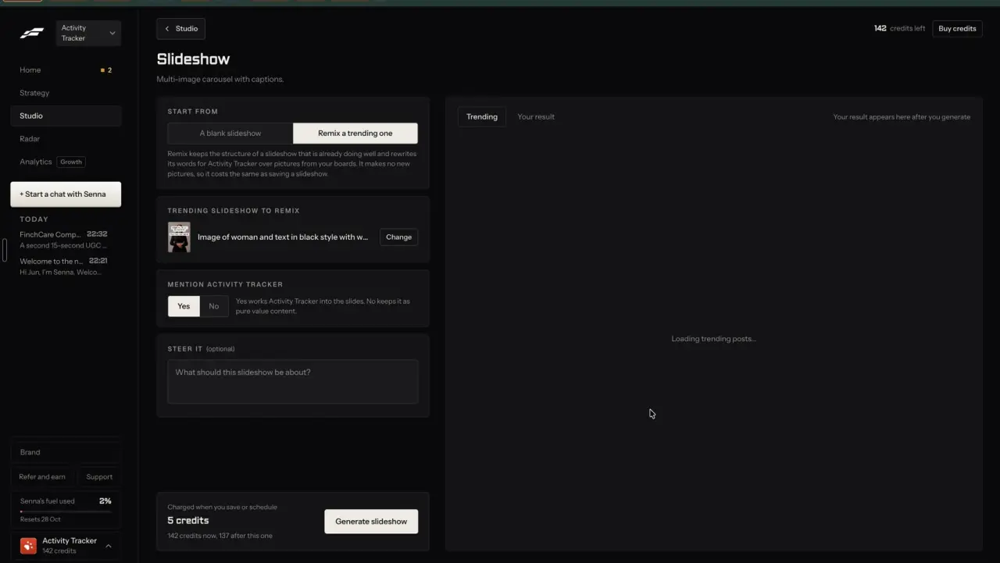
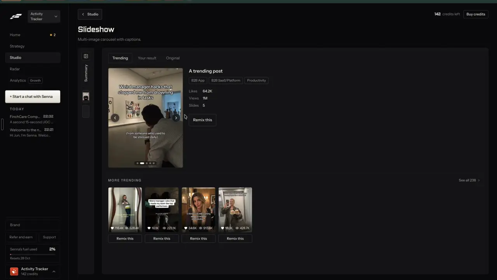
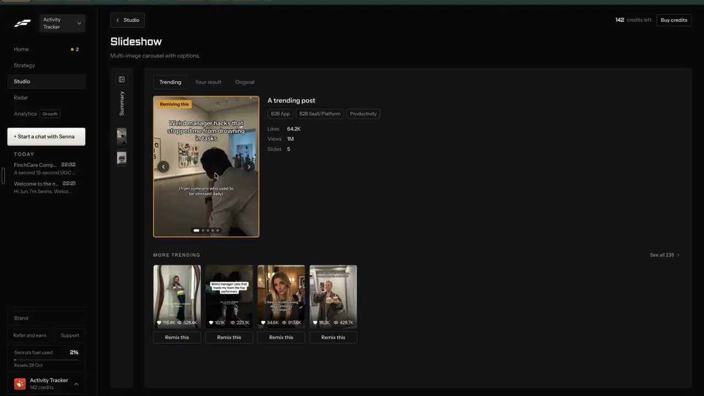
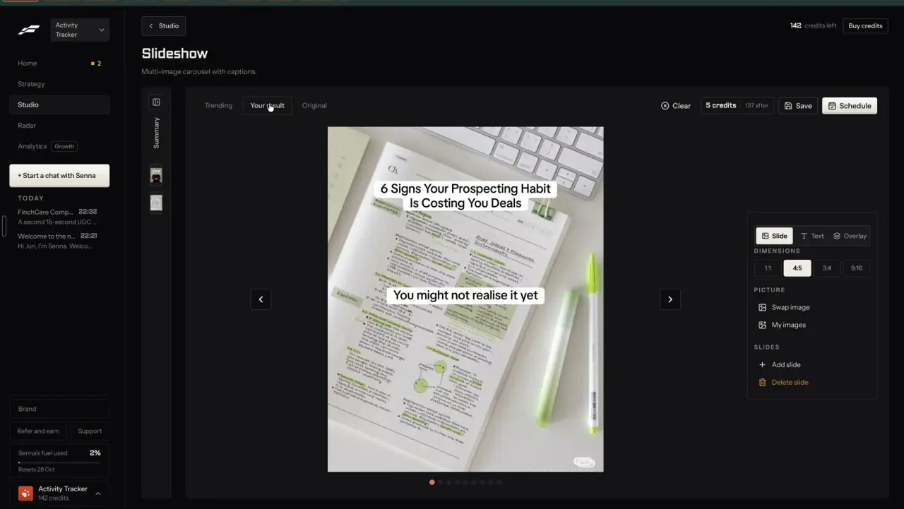

# Original beside your version

`remix-compare` | remix | phase 1 | status: live (Leo's sign-ins, 21 Oct 2026) | /north-star#remix-compare

## Leo asked

No direct ask; from the competitor research.

## How the best do it

Fastlane puts three tabs over every remix result: "Trending", "Your result" and "Original".

1. Before you generate, the slideshow page shows two tabs, "Trending" (selected) and "Your result", with grey text "Your result appears here after you generate" and "Loading trending posts..." in the body. The source sits in the setup column as "TRENDING SLIDESHOW TO REMIX" with a thumbnail, an AI description of the image and a "Change" button.

   

2. On "Generate slideshow" the panel jumps to "Your result" with a spinner and "Generating your content...". The setup column stays usable while it runs. About 12 seconds later the tabs become "Trending" | "Your result" | "Original" and the setup folds into a "Summary" rail.

   

3. The "Trending" tab shows the niche's top trending slideshow as a 9:16 carousel, which is not always the post you remixed. When your result was made from it, an orange "Remixing this" tag sits top left and the image gets an orange border (1:49). After Leo remixed a different post, the same tab showed the same post with a plain "Remix this" button under its numbers instead (2:50). Beside the carousel: "A trending post", topic chips ("B2B App", "B2B SaaS/Platform", "Productivity") and rows "Likes 64.2K", "Views 1M", "Slides 5". Under it, "MORE TRENDING" with "See all 238 >" and four thumbnails, each with likes, views and a "Remix this" button. The header actions (Clear, credits, Save, Schedule) hide on this tab.

   

4. "Your result" holds the editor: slide canvas, "Clear", "5 credits | 137 after", "Save", "Schedule".

   

5. The "Original" tab was never opened in the recording, so what it shows is unverified. In chat, the attached remix card has a "Show the original" dropdown (t252). Wall of Text uses the same three tabs; there the result keeps the original's footage and only the words are new (notes-3 F6).

Other tools: no other competitor in the research documents an original-beside-result tab for a remix. The nearest are FeedHive's "Recycle history" tree, which shows the original as a "Core" node with every recycled variant and its date ([docs](https://docs.feedhive.com/planning-and-scheduling/recycling-content)), Eden's "Freeform canvas", which places saved posts, links, drafts and chats side by side ([eden.so](https://eden.so/)), AuthoredUp's "Side-by-side post comparison" of your own posts' numbers ([pricing](https://authoredup.com/pricing)) and Eden's "Compare variations" on a brand's ads ([eden.so](https://eden.so/)).

## What we have today

- Clone a reel (`/clone`, `src/pages/CloneReelPage.tsx`, result grid near line 1262) already shows the source and your version on one page: on large screens SourceCard spans the top, BreakdownCard and VisualsCard sit left and VersionCard right, while phones read VersionCard first; the page has no "more like this" row.
- Write (`/generate`) receives the other remixes as a text brief. The original caption travels inside `ctx` (`buildRemixUrl` in `src/lib/topPosts.ts`, `remixUrl` in `src/lib/following.ts` for non-video posts, `buildAdWriteUrl` in `src/lib/adsSwipe.ts`, `remixUrl` in `src/lib/accountAudit.ts`). Following's video posts go to `/clone?url=` instead. `GeneratePage.tsx` reads `ctx` into the idea context box at line 1074 and drops it from the URL at line 1085. The unfinished brief, `ctx` included, stays in sessionStorage (`cs-write-brief-<scoped uid>`) only until a draft exists. `persistDraftEntry` (line 1757) saves no source or context, so once a variation is picked the original is gone from the draft.
- Write's "Vibe locked in" banner (`GeneratePage.tsx` around line 2495) shows the hook of a post picked with "Use as vibe" on `/inspiration`, and `vibeSourceId` is saved on the draft. That one line is the only source Write shows beside a draft today.
- Creator lookup on `/analytics` (`src/components/CreatorLookup.tsx`), Trends (`buildTrendRemixUrl` in `src/lib/trends.ts`) and `/market` (`postWriteUrl` in `src/lib/market.ts`) also send the original only inside `ctx`.
- `similarPosts(item, all, n)` in `src/lib/postInsights.ts` already feeds "Similar ideas to study" in the swipe drawer (`src/components/PostDetailDrawer.tsx`).
- Planned, not built: `remix-everywhere` shows "Show the original" in the Remix sheet before making, and `remix-closeness` adds `sharedRuns` and the `remix.flags` record of copied lines.

Status partial: only Clone a reel shows the original beside your version.

## Build

This item reads `draft.source` (the snapshot `remix-source-trail` saves) and, for drafts made in the Remix sheet, `draft.remix` (`keep` from `remix-intent`, `close` and `flags` from `remix-closeness`). Build it after `remix-source-trail`; the `remix` lines appear once those items ship.

### Screens and states

Where: above the draft card in Write, and above the slides in the carousel maker (`/carousel?draft=<id>`), because the Remix sheet opens carousels there. Shown whenever the open draft has a `source`, on Leo's sign-ins only (`leoOnly(email)`, email from `supabase.auth.getSession()` the way `NorthStarPage.tsx` reads it, or `useLeoOnly()` from `business-cost-preview` once that lands), built as a new component `src/components/RemixCompare.tsx` with its helpers in `src/lib/remixCompare.ts`.

Phones (under `lg`): three tabs.

```
[ Your version ] [ Original ] [ More like this ]
```

Large screens: the original in a 360 px column on the left (sticky), your version on the right, "More like this" as a row under both.

```
| Remixed from @handle, Instagram reel  [Open original] |  Draft card (as today)          |
| cover                                                 |                                 |
| What they wrote, for reference only                   |                                 |
| "first 400 characters..."                             |                                 |
| 32.6K views  249 likes  2.4x their usual              |                                 |
| What changed                                          |                                 |
| Made with: Keep the structure, Balanced               |                                 |
| Hook shape kept: [N] signs your [thing] is [problem]  |                                 |
| No lines match the original.                          |                                 |
| More like this:  [card][card][card][card]                                                |
```

Original pane, all from data on the device (no fetch):
- Header: platform icon, "@handle", the kind label, and "Open original" (new tab) when `source.url` exists.
- Cover picture when `source.cover` exists (top posts have `/covers/<shortCode>.jpg`).
- The caption excerpt from `source.caption`, which is never longer than 400 characters, then the numbers in `compactNum` form when known, with "{ratio}x their usual" when the source has a ratio.
- What changed, built by `whatChanged(draft, teardown)`:
  - "Made with:" the intent chip label (`draft.remix.keep`, labels from `remix-intent`) and the closeness level (`draft.remix.close`). Left out for drafts made in Write.
  - "Hook shape kept:" the hook pattern from the full teardown (`loadTeardown(uid, source.key)` from `remix-teardown`), else the inline `source.teardown.hook`, and nothing when neither exists.
  - Copied lines: `sharedRuns(source.caption, draft.draft)` from `supabase/functions/remix/logic.ts` (`remix-closeness`), run again on every view so edits count, merged with `draft.remix.flags.copied` from the time it was made. None: "No lines match the original." Some: the chip "Shares words with the original" and the lines listed under it.
  - When `draft.remix.flags.claim` is true: the chip "Uses a figure or claim from the original. Check it or take it out."
  - Chips warn and never block Copy, the same as the compliance chips.

More like this pane: up to 4 cards, picked by `moreLikeThis(source)`:
- top post sources: `similarPosts` over the swipe file;
- Following sources: the same account's other posts (Following keeps the newest 12 per account), best first by views, or likes plus comments where views are hidden, the measure `followStats` uses;
- ad sources: other ads in the same industry from `ADS` (`src/lib/adsSwipe.ts`), longest running first (`daysRunning`);
- own posts, pasted links and uploads: nothing (empty state).
Each card shows cover or first line, numbers and the `RemixButton` from `remix-everywhere` (it opens the Remix sheet over this page); until that ships, the card's existing remix link.

States:
- Draft has no source: the strip does not render.
- Source has no caption: the pane shows the header and "No text was saved with this source."
- Writing in progress: the Original and More tabs stay usable while variations stream.
- The source rotated out of the weekly drop: the pane still shows the snapshot saved on the draft. Never resolve the source again at view time.
- Loading, failed, refused and over the daily cap: none apply. The strip makes no network call.

### Copy

- Tabs: "Your version", "Original", "More like this"
- Header label: "Remixed from"
- Own post kind label: "Your post"
- Link: "Open original"
- Caption label: "What they wrote, for reference only"
- No caption: "No text was saved with this source."
- Section heading: "What changed"
- Lines: "Made with: {intent}, {closeness}", "Hook shape kept: {pattern}"
- No match: "No lines match the original."
- Chips (same words as `remix-closeness`): "Shares words with the original", "Uses a figure or claim from the original. Check it or take it out."
- More like this empty: "Nothing similar in your library yet." with the link "Browse top posts" (`links.swipe()`)

### Data

Nothing new is stored. The pane reads `draft.source` and `draft.remix` (synced inside `content-studio-drafts-<scoped uid>`) and the teardown store from `remix-teardown`. The open tab lives in the URL. No schema change.

### AI and cost

None. Copied lines are counted by `sharedRuns`, a measurement, so there is no Jev call and no cap. More like this reuses the code ordering that already exists (`similarPosts`, the numbers, `daysRunning`) and adds no new judgment. Cost per view: 0.

### Deep links

- `/generate?draft=<id>&compare=original` opens the Original tab on phones and scrolls to the original column on large screens; `/carousel?draft=<id>&compare=original` does the same in the carousel maker.
- `compare=more` opens More like this on either page.
- The default (your version) is left out of links. Tab switches replace the history entry.
- Add `compare?: "original" | "more"` to `links.generate` and `links.carousel` in `src/lib/links.ts`, and rows to the Create pages table in `docs/deep-links.md`.

## Done when

- [ ] A draft made from each remix entry (the Remix sheet, Top posts, Following, Ads, Account audit, Clone a reel) shows the strip in Write or the carousel maker on Leo's sign-ins; any other sign-in sees both pages exactly as before.
- [ ] At 390 px the three tabs fit with no horizontal scroll; at 1440 px the original sits beside the draft.
- [ ] `compare=original` and `compare=more` open the right tab, and switching tabs rewrites the URL without a new history entry.
- [ ] Editing a draft so it repeats 6 words of the caption makes the copied-lines chip appear on the next view; removing them clears it.
- [ ] More like this shows at most 4 cards, never the source itself, and the empty state when there is nothing.
- [ ] The network tab shows no request when the strip opens or tabs switch.
- [x] `src/data/northStar.ts` item flipped (status and `ours`) in the same commit, and this spec's status line ticked.

## Tests

- `src/lib/remixCompare.test.ts`: `whatChanged` lists the intent and closeness labels only when `draft.remix` exists, prefers the full teardown's hook pattern over the inline one, and merges live `sharedRuns` with stored `flags.copied` without repeats.
- Same file: `moreLikeThis(source)` returns 4 or fewer, never includes the source, and returns an empty list for own posts, links and uploads.
- `src/lib/links.test.ts`: `links.generate({ draft, compare: "original" })` and `links.carousel({ draft, compare: "more" })` build the URL, and the default leaves `compare` out.

## Open questions

- What Fastlane's "Original" tab shows is unverified. This spec shows the saved snapshot. Leo decides if he wants the source's slides or video played inside the pane.
- The live copy check only sees the 400-character excerpt saved on the draft, so a line copied from further down a long caption shows only through the stored `flags.copied` from the time it was made.
- Whether a team leader can turn the chips into a block belongs to `trust-compliance-check`.
- Built 2026-10-20: the stored `flags.copied` lines show only while the draft still has them (the same test as Write's remix chips), so taking a copied line out clears it, as Done when asks.
- Built 2026-10-20: on large screens the carousel maker shows the strip as one block above the slides (the original, then More like this beside it), not as a 360 px column beside them. The editor is already two columns there, and a third would leave the slide preview under 300 px wide. Write keeps the column beside the draft. Open for Leo (2026-10-20): at 1440x900 this block moves Preview and Download all from y 367 to y 1214 on a remixed ad carousel, below the fold, because the original shows its whole caption (823 px tall). Either keep it above the slides and make it compact on large screens (cover thumbnail, handle and What changed in one row, the caption cut to 3 lines with a way to show the rest), or put the original in a column beside the slides as the Build section says. Until he picks, Done when's 'at 1440 px the original sits beside the draft' is met in Write only.
- Built 2026-10-20: the carousel maker shows the strip only while the slides are that post's own (carousel `d:<post id>`): pasted slides keep the last post's id in the page state.
- The carousel maker reads the post's text only (`draft.draft`), so edits made on the slides don't count toward copied lines.

## Related

remix-source-trail, remix-everywhere, remix-teardown, remix-closeness, remix-intent, remix-variations, find-ad-detail, edit-slideshow
