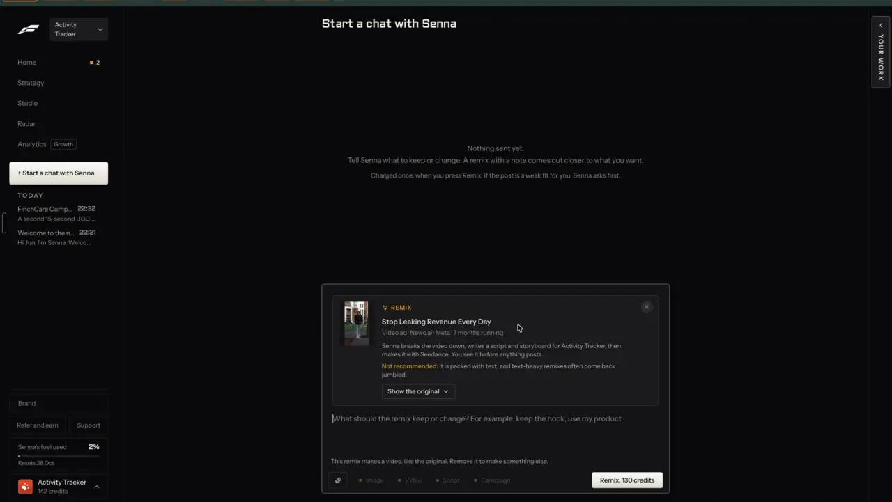

# Is this a good fit for you?

`remix-fit-check` | remix | phase 1 | status: missing | /north-star#remix-fit-check

## Leo asked

No direct ask; from the competitor research.

## How the best do it

Fastlane judges each ad before you spend and says what Remix will do. The ad modal on Radar has a box "What Remix does": "Senna breaks the video down, writes a script and storyboard for Activity Tracker, then makes it with Seedance. You see it before anything posts." Under it, in orange: "Not recommended: it is packed with text, and text-heavy remixes often come back jumbled." The modal also states "Why it works: Their longest running ad right now." (4:01).


The same text and warning ride along on the REMIX card in the chat composer, and the empty thread promises a check before the charge: "Charged once, when you press Remix. If the post is a weak fit for you, Senna asks first." (4:12). Leo did not press Remix, so what "asks first" looks like is not in the recording (notes-3, open question 11).



Its Library ranks for fit too: "24 of these match what you sell, shown first. Top posts in Vertical / SMB business software, ops & CRM lately. And the ads your competitors run now."


No other product in the research checks a source against the brand before a remix. The nearest is Sandcastles, which shows "Tell us what you make content about" and a "Describe your content" button when the workspace has no Persona, instead of guessing how to adapt an idea. [ideas](https://help.sandcastles.ai/ideas)

## What we have today

- /swipe's "Best for you" sort (`sort=for-you`, src/lib/postInsights.ts) lifts top posts whose derived topic, angle and audience labels match the Playbook (`personalMatch`). It ranks; it never warns or explains.
- Clone a reel's prompt quietly switches topic when the original's angle cannot be made compliant ("keep its format and switch to a money, protection or planning topic that fits", supabase/functions/clone-reel/logic.ts), without telling the adviser.
- Jev already judges ideas before Write makes them: writing-judge mode "carousel" says when a carousel idea has no sequence and would read better as a text post, and mode "idea" flags a thin idea (supabase/functions/writing-judge, cap `writing-judge` 60), and this item copies their shape. Nothing judges a source before a remix, and no remix says what it is about to do.

## Build

Build after remix-everywhere, inside its Remix sheet and `remix` function, so the `leoOnly` gate and the REMIX_USERS check cover it. A fit check runs when the sheet opens, shows one line under "What Remix does", and makes the Remix button ask first on a weak fit. It also finishes the "What Remix does" text so it names every step for the chosen format.

### The check

New mode `fit` in `supabase/functions/remix`, Jev only, no LLM. Request: `{ mode: "fit", source, brand: { name, oneLiner, audience, topics }, as: string[] }`. One `askJev` call (jev-1.13.0) with the source and brand in the state and these questions:

| Id | Type | Question | Asked when |
| --- | --- | --- | --- |
| `serves` | noul | "Would the people `brand` serves care about the problem or idea in `source`, once it is retold for them?" | always |
| `retell` | noul | "Can `source` be retold without its original footage, people or brand? No when it depends on one person's face or story, a celebrity, a live event, a product demo, or footage that cannot be made again." | always |
| `masSafe` | noul | "Can the idea in `source` be told by a licensed financial adviser in Singapore without promising returns, naming an insurer's product or a fund, or giving personal advice to a stranger?" | always |
| `textHeavy` | noul | "Is most of what `source` says carried by words written on screen or on slides, rather than spoken or shown?" | a video format is picked and the source is a video or carousel |

The verdict is code over those numbers, in `fitVerdict(answers)` in `supabase/functions/remix/logic.ts`:

- `poor` when `serves` is under 0.3.
- `weak` when `serves` is from 0.3 to under 0.55, or `retell` is under 0.5, or `masSafe` is under 0.5.
- `good` otherwise.
- `textHeavy` of 0.6 or more adds the text-heavy reason to any verdict.
- When Jev returns null the verdict is `unknown`, and the sheet behaves as if there were no check.

Every reason comes from a fixed string chosen by which number missed, so no LLM writes it. These thresholds are proposals until the shadow run below.

Shadow run before turning it on: run `fit` over the 136 top posts, 21 ads and 10 trends in src/data (167 sources) for each of Leo's brand profiles, about 167 Jev calls and US$0.01 a brand. Use a script `scripts/fit-shadow.mjs` that imports `askJev` from ../supabase/functions/_shared/jev.ts and passes `{ env }`, the way scripts/sg-feeds.mjs does. The script prints the exact number of sources and brands before its first Jev call and stops when the count is over 200 per brand. It reads each brand's name, one-liner, audience and topics read-only from Leo's synced rows in `cs_user_data` (keys `content-studio-profiles-<uid>` for the brand list and `content-studio-positioning-<uid>` or `content-studio-positioning-<uid>~<profile id>` per brand, as `scoped()` in src/lib/profiles.ts builds them, under user id 13b28b1d-2ecb-40be-b3a9-aefc90366f9b and the one starting 40f07a18), and it writes nothing back. Put each answer beside today's logic, the `personalMatch` score from postInsights, and read every case where the two disagree, plus the 30 lowest and 30 highest `serves` per brand. Set the thresholds from that reading and note them in the code comment.

### What Remix does

`whatRemixDoes(source, choices, brand)` in src/lib/remix.ts builds the box from fixed parts and replaces the single sentence in remix-everywhere:

- Reading: "Reads this <reel | carousel | post | ad | trend>" plus ", breaks it down" when no teardown is cached yet.
- Making, by format: "writes a text post" / "writes a carousel and lays it out in your brand colours" / "writes a script and shot list to film" / "writes a 30-second script, records the voiceover and makes a video of <your photo | an AI presenter> saying it" / "writes 3 to 6 scenes, makes a picture for each and joins them over a voiceover".
- For whom: "for <brand> in your voice" (or "in a plain voice" with no voice saved).
- Closing, always: "You see it before anything posts."

### Screens and states

```
What Remix does
Reads this reel, breaks it down and writes a carousel for MoneyBees in your voice,
laid out in your brand colours. You see it before anything posts.
(!) Weak fit: it leans on its own footage, so a remix keeps only the idea.
```

- Checking: "Checking the fit..." with a small spinner, under the box. The Remix button stays enabled. A press during the check waits for it, at most 5 s (JEV_TIMEOUT_MS), then goes on as below.
- Good: "Good fit for <brand>." in the muted text colour with a small green dot.
- Weak: one warning line in the amber warning colour, starting "Weak fit:" with the first reason that applies.
- Poor: one warning line starting "Not recommended:" with the reason.
- Text-heavy with a video format picked: the line "Mostly words on screen, so it works better as a carousel than a video." and a small "Make a carousel instead" button that switches the format chips to Carousel.
- Unknown (Jev null, over the `remix-fit` cap, or offline): no line at all.
- Ask first: on weak or poor, pressing "Remix" spends nothing yet. The button row becomes "This one is a weak fit. Remix anyway?" (or "This one isn't recommended. Remix anyway?") with "Remix anyway" as the primary button and "Pick another" as a quiet button that closes the sheet. "Remix anyway" starts the job straight away.
- A changed format re-runs the check only when it adds or removes `textHeavy`; results are cached per source, brand and video-or-not.

### Copy

| Where | String |
| --- | --- |
| Checking | "Checking the fit..." |
| Good | "Good fit for <brand>." |
| Serves low | "Weak fit: people you serve may not care about this topic." / "Not recommended: people you serve may not care about this topic." |
| Retell low | "Weak fit: it leans on its own footage or people, so a remix keeps only the idea." |
| MAS-safe low | "Weak fit: it needs a new angle to be MAS-safe, so the remix keeps the format and changes the topic." |
| Text-heavy | "Mostly words on screen, so it works better as a carousel than a video." |
| Switch | "Make a carousel instead" |
| Ask first | "This one is a weak fit. Remix anyway?" / "This one isn't recommended. Remix anyway?" |
| Buttons | "Remix anyway", "Pick another" |
| What Remix does | the parts listed above |

### Data

- Device cache `cs-remix-fit-<scoped uid>`: `Record<"<key>|<video|text>", { verdict, reasons: string[], at }>`, at most 200 entries, each kept 7 days. It is a hint that saves Jev calls, so it stays out of sync.
- The verdict is passed to `make` so the prompt can follow the MAS-safe reason (switch topic, keep format), and saved on the draft's `remix.fit` for remix-source-trail and remix-compare. Neither needs a schema change.

### AI and cost

- Jev only: 3 or 4 nouls in one call, about 1,500 input tokens, about US$0.0001 a check at $0.042 per million input tokens.
- New cap `"remix-fit": 100` in usageCaps.ts, a guard against a runaway loop rather than a cost limit. Over it, the check returns `unknown` with no error shown.
- Order in the function, as for `make`: JWT, the REMIX_USERS check, `consumeUsage(admin, uid, "remix-fit")`, then `askJev`. When `askJev` returns null the function calls `refundUsage` for that use and answers `{ verdict: "unknown" }`, so an outage or a missing TYPESAFE_API_KEY never eats the day's checks.
- The shadow run costs about US$0.01 per brand, once.

### Deep links

The fit line has no view of its own. `?remix=<key>` reopens the sheet and the check runs again, or comes from the cache. The ask-first step is a moment inside the sheet and never lands in the URL.

## Done when

- [ ] The shadow run is done, its disagreements read, and the thresholds in code carry a comment with the date and what they came from.
- [ ] Opening the sheet on a source shows the fit line within 2 s on a warm connection, and "What Remix does" names every step for the picked format.
- [ ] A weak or poor source asks first, and "Remix anyway" goes ahead without a second check.
- [ ] A text-heavy video source with "You speaking" picked shows the text-heavy line and "Make a carousel instead" switches the format.
- [ ] With TYPESAFE_API_KEY unset (local function run), the sheet shows no fit line and Remix works.
- [ ] Build, full vitest, 390 px and 1440 px; northStar.ts flipped.

## Tests

- `supabase/functions/remix/logic.test.ts`: `fitVerdict` gives poor, weak, good and unknown on fixed numbers at and either side of each threshold; `textHeavy` is only asked with a video format; each failing question maps to its exact reason string.
- `src/lib/remix.test.ts`: `whatRemixDoes` for every source format and output format pair, with and without a voice and a cached teardown.
- No component test (vitest runs in node with no DOM library here). `src/lib/remix.test.ts`: `pressAction(verdict, confirmed)` returns "ask" for weak and poor until confirmed and "start" after; good and unknown return "start" at once. The sheet only renders what it returns.

## Open questions

- Should the fit also rank cards on /swipe and the ads tab ("24 of these match what you sell, shown first")? That would run Jev over whole lists and fits find-niche-feed better than this item.
- After a "Remix anyway" on a poor fit, should the adviser be able to say "stop asking for this kind"? That would be a learned preference for agent-memory.
- 20 Oct 2026 (phase-1 build): the thresholds in `FIT_AT` (supabase/functions/remix/logic.ts) are this spec's proposal until the shadow run. `node scripts/fit-shadow.mjs brands.json --go` (or with SUPABASE_SERVICE_ROLE_KEY) runs it, read-only; it needs Leo's brand rows, which RLS keeps from the anon key, so it waits for an export or the service key. "What Remix does" keeps the short format words the phase-1 contract fixed ("writes a carousel"), not this spec's longer per-format steps. A press with a video format picked also asks first for the video's price (the build brief's money rule), in the same row as a weak-fit question, so it is one confirm per press.

## Related

remix-everywhere, remix-any-format, remix-your-brand, remix-teardown, find-ad-detail, find-niche-feed, agent-approvals, agent-memory, trust-compliance-check
