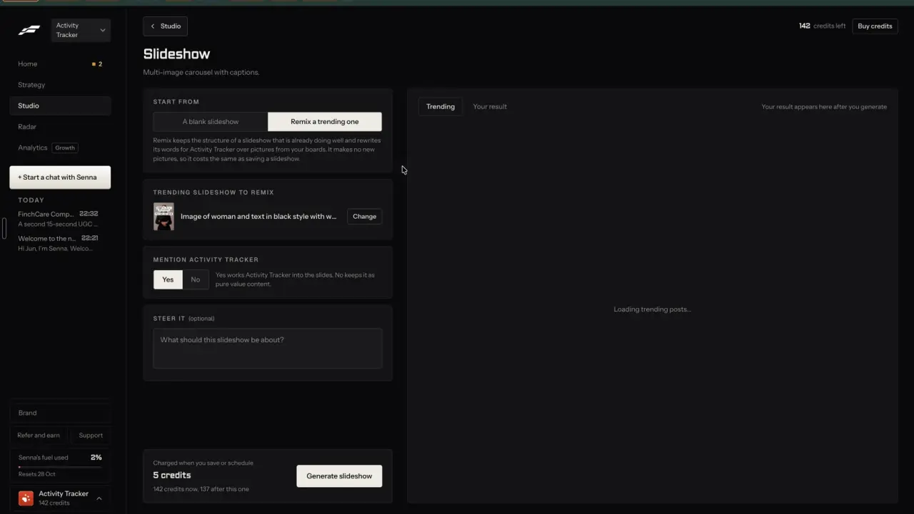

# Choose what to keep

`remix-intent` | remix | phase 1 | status: partial | /north-star#remix-intent

## Leo asked

19 Oct 2026: "the idea is that one can remix any content format and the ai will regenerate"

What the AI regenerates and what it keeps is the choice this item puts in front of the user.

## How the best do it

Fastlane fixes the intent per format and adds a free note. The Slideshow page has "START FROM" with "A blank slideshow" / "Remix a trending one", and the helper says what is kept: "Remix keeps the structure of a slideshow that is already doing well and rewrites its words for Activity Tracker over pictures from your boards. It makes no new pictures, so it costs the same as saving a slideshow." (2:37). Wall of Text says "Remix keeps the video, sound and shape of a wall of text that is already doing well and rewrites the text for Activity Tracker." (3:24). The chat remix has no menu; its note box asks "What should the remix keep or change? For example: keep the hook, use my product" (4:12).




Others name the intents:

- Revid.ai lists seven ways to remix a viral video: "Same energy, new script", "Make it about your topic", "Post the Part 2", "Same footage, new look", "React on camera", "Your face in it", "Reuse the script". A typical 30 s video is about 40 to 80 credits. [ai-instructions](https://revid.ai/ai-instructions), [features](https://revid.ai/features). Its feature page names three modes: "Repurpose" keeps the idea, hook and pacing with a new script and visuals; "Part 2" continues the story with a new payoff; "Restyle" changes the look of footage you have rights to. Its FAQ draws the line at re-uploading other people's footage. [repurpose viral videos](https://www.revid.ai/features/repurpose-viral-videos)
- Sandcastles: "New Script" offers Script from Scratch, Remix an Existing Idea (topic, substance and writing style carry over) and Fix an Existing Script, at 1 credit a script with free edits. [3 paths](https://help.sandcastles.ai/scripts-3-paths), [credits](https://help.sandcastles.ai/credits-v3)
- MakeUGC Ad Remake keeps the hook, pacing and style of a reference ad and swaps in your product, from two inputs: "Reference video *" and "Product image *". 100 credits a video on Seedance 2.0. [ad remake](https://www.makeugc.ai/ad-remake-feature)
- Creatify Ad Clone keeps hook style, pacing and CTA flow and changes the words, product, avatar and visuals. [ad clone](https://creatify.ai/features/ad-clone)
- ViralBrain (2026 entrant) "Apply Pattern" reuses a post's structure on your topic. [viralbrain.ai](https://www.viralbrain.ai/). EasyGen takes a post format that worked and applies your own angle to it. [easygen.io](https://www.easygen.io/)
- Vamos "Adapt what works": hook, structure and format carry over, and in its words "Their topic does not". [docs](https://docs.getvamos.ai/en/articles/13004958-adapt-what-works)

## What we have today

- Clone a reel (/clone) writes three concepts, each with a "keeps" line and a "changes" line (`Concept` in supabase/functions/clone-reel/logic.ts). The first run (cap `reel-clone` 20) writes the version for concept 1; the adviser can build another concept from the cached post (`startConceptBuild` in src/lib/reelClone.ts, cap `reel-concepts` 20). This is the only place a user chooses what is kept.
- The account audit's own-post remix (remixUrl in src/lib/accountAudit.ts) always keeps the topic and asks for a new hook and example.
- Every other link fixes one intent in its `ctx` text: "Keep the mechanic and structure; do not copy the wording" (buildRemixUrl), "opens the same KIND of way" (buildAdWriteUrl), "Write my own take on the idea" (following.ts).
- There is no menu, no Part 2, no reaction post, and no way to say "keep the hook only".

## Build

Build after remix-everywhere. It lives inside the Remix sheet, so it inherits that item's `leoOnly` gate and the server's REMIX_USERS check. A row of intent chips goes into the sheet, and the chosen intent travels to the `remix` function as `keep`, where it selects one instruction block in the prompt without adding a paid call.

### The intents

| `keep` | Chip | Shown for | Kept from the original | Made new |
| --- | --- | --- | --- | --- |
| `structure` (default) | "Keep the structure" | every source | beat order, number of points, length within 10 percent, where the ask sits | the hook line, the angle for your audience, every word |
| `hook` | "Keep the hook" | every source | the hook's pattern from the teardown (`hook.pattern`) | everything after the hook, in your own order |
| `energy` | "Same energy, new script" | video sources (`format` video) | tone, pace and length | the script, the beats and the hook |
| `topic` | "Make it about my topic" | every source | the format and the hook style | the topic, picked from your brand's topics |
| `part2` | "Part 2" | your own posts (kind `own`) | the topic and the promise of the original | a follow-on with a new payoff |
| `react` | "React to it" | other people's posts: keys `top:`, `follow:`, `insp:`, `link:` (never `ad:`, `trend:`, `hubtrend:` or your own) | its main point, restated and credited once | your view on it |
| `face` | "Your face in it" | video sources (`format` video) | the structure | output becomes "You speaking" with your face (needs remix-any-format and remix-your-brand) |

"Same footage, new look" is left out of phase 1: it needs the original footage, which is only ours to reuse for the adviser's own videos, and those files live on one device.

When `topic` is picked, a second row appears with the brand's topics as chips (from `loadPositioning(...).topics`, src/lib/positioning.ts), the first one selected. With no topics saved, the row shows "Add your topics" linking to `/plan?view=setup`, the positioning form where topics are typed (PlanPage; /fads only seeds topics when the list is empty).

When `face` is picked and remix-any-format has not shipped yet, the chip is not shown at all.

### Screens and states

```
Keep   [Keep the structure *] [Keep the hook] [Same energy, new script]
       [Make it about my topic] [React to it] [Your face in it]
       Keeps: beat order, number of points, length. New: hook and every word.
Topic  [Retirement *] [CPF] [Insurance basics]      (only with "Make it about my topic")
```

- Default: "Keep the structure" selected, with its one-line explainer under the chips.
- Each chip press updates the explainer line, the "What Remix does" box and `keep` in the URL within one frame. Nothing is charged until "Remix".
- The chips are disabled while a remix is making, and the done state shows which intent it used ("Kept the structure").
- On a source with no teardown, `hook` still works: the server derives the pattern from the first line of the text.
- Chips wrap on a 390 px screen; each is at least 40 px tall.

### Copy

| Where | String |
| --- | --- |
| Row label | "Keep" |
| Chips | "Keep the structure", "Keep the hook", "Same energy, new script", "Make it about my topic", "Part 2", "React to it", "Your face in it" |
| Explainer, structure | "Keeps: beat order, number of points, length. New: hook and every word." |
| Explainer, hook | "Keeps: the shape of the first line. New: everything after it." |
| Explainer, energy | "Keeps: tone, pace and length. New: the script." |
| Explainer, topic | "Keeps: the format and hook style. New: the topic." |
| Explainer, part2 | "Follows your post with a new payoff." |
| Explainer, react | "Says what you think of it, and credits the original." |
| Explainer, face | "Same structure, said by you on camera." |
| Topic row label | "Topic" |
| No topics | "Add your topics" |
| Done line | "Kept the structure" / "Kept the hook" / "Same energy" / "Moved to <topic>" / "Part 2" / "Your reaction" / "With your face" |
| "What Remix does" verb | "keeps its structure", "keeps its hook", "keeps its energy", "moves it to <topic>", "writes its part 2", "writes your reaction to it", "puts you on camera in it" |

### Data

- `keep` lives in the URL only. The default is chosen fresh each time; the last pick is not remembered, so a remix never starts from an unexpected mode.
- The topic pick is sent as `topic` in the request. In the URL it is `about=<slug>` while the `topic` intent is selected. The name is not `topic` because /swipe already uses `topic=` as a filter (docs/deep-links.md), and the sheet opens over /swipe.
- The only stored change is on the draft: `remix.keep` (the field remix-everywhere adds) records the intent, so remix-source-trail and remix-compare can show which one made it.

### AI and cost

- The `make` request gains `keep` and, for `topic`, `topic`. `supabase/functions/remix/logic.ts` holds `KEEP_RULES: Record<Keep, string>` and puts the one block into the prompt after the shared rules:
  - structure: "Keep the original's beat order, its number of points, its length within 10 percent and where its call to action sits. Write a new hook and every line new, about the adviser's topic for their audience."
  - hook: "Keep the shape of the original's first line: <pattern>. Fill it with the adviser's own specifics. After the first line, write the post the adviser's way; the original's order is not required."
  - energy: "Keep the original's tone, pace and length. Write a new script for the adviser's audience; the beats and the hook can change."
  - topic: "Keep the original's format and hook style. The topic is <topic>, for the adviser's audience."
  - part2: "This is the adviser's own earlier post. Write its part 2. Open with one short line saying it is part 2, make sense to someone who missed part 1, and deliver a new payoff the original promised or left open. Do not repeat its points."
  - react: "Write the adviser's reaction to the original's main point. Restate that point in your own words and credit @<author> once. Agree, add to it or correct it from the adviser's view. Never repeat its numbers as fact, and never endorse a promised return or a named product."
  - face: the structure block, with the output set to the "You speaking" script by remix-any-format.
- The server rejects a `keep` the source cannot take (part2 on a non-own source, react on an ad or own post, energy or face on a non-video) with 400 `bad_request` "That way of remixing doesn't fit this post." The sheet never offers those, so this only guards hand-made requests.
- No Jev question: the user picks, and the default is fixed. No new cap and no extra cost; it rides on `remix-make`.

### Deep links

`?remix=<key>&keep=hook`, `?remix=<key>&keep=topic&about=cpf`. Both replace the history entry; `structure` is the default and left out. An unknown or unavailable value falls back to `structure` silently.

## Done when

- [ ] The sheet shows only the chips that fit the source (checked on a reel, a carousel, an ad, a trend, a followed post and an own post).
- [ ] Each intent produces a visibly different result from the same source: the hook pattern survives under "Keep the hook", the topic changes under "Make it about my topic", part 2 opens by saying so, and the reaction credits the author once.
- [ ] `keep` and `about` in the URL reopen the same choice after a reload, and opening the sheet over `/swipe?topic=cpf` leaves the swipe filter alone.
- [ ] A hand-made request with `keep=part2` on a top post gets the 400.
- [ ] Build, full vitest, 390 px and 1440 px; northStar.ts flipped.

## Tests

- `src/lib/remix.test.ts`: `intentsFor(source)` returns the right chips for each kind and format, and never `part2` for others' posts or `react` for ads, trends or own posts.
- `supabase/functions/remix/logic.test.ts`: each `keep` puts exactly its block in the prompt; `hook` includes the pattern; `react` includes the author once; an unavailable `keep` is refused.
- One recorded run per intent on a fixed top post, checked by hand once and kept as a fixture for the prompt test (no live calls in vitest).

## Open questions

- "Same footage, new look" on the adviser's own videos needs the original file, so it fits better once brand-media-library keeps media in the cloud; when to add it is Leo's call.
- Whether "React to it" should also make a stitch-style video that shows the original needs the original creator's permission and is left out with other people's footage.

## Related

remix-everywhere, remix-teardown, remix-closeness, remix-any-format, remix-your-brand, remix-own-winners, remix-variations, remix-compare, people-my-face
