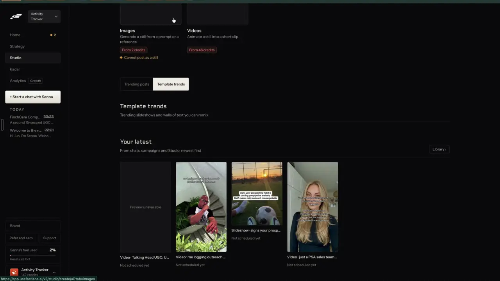

# Every remix keeps its source

`remix-source-trail` | remix | phase 1 | status: live (Leo's sign-ins, 20 Oct 2026) | /north-star#remix-source-trail

## Leo asked

No direct ask; from the competitor research.

## How the best do it

Fastlane carries the source with the remix from the first screen to the editor, and in chat too.

1. The create page names the source in its own card, "TRENDING SLIDESHOW TO REMIX": a thumbnail, an AI description of the picture ("Image of woman and text in black style with w...") and a "Change" button.

   

2. In the editor, the "Trending" tab tags the post the result came from with an orange "Remixing this" label and an orange border, with its likes, views and slide count beside it.

   

3. A remix started from an ad lands in chat as an attached card: orange "REMIX" label, thumbnail, headline "Stop Leaking Revenue Every Day", the line "Video ad - Newo.ai - Meta - 7 months running", what Remix will do, a fit warning, a "Show the original" dropdown and an X to detach it.

   

4. "Your latest" lists made pieces with the format and title joined by a dot ("Slideshow" then "signs your prosp...") over "Not scheduled yet". The recording does not show whether the library keeps the source after saving (unverified).

   

Others:
- Revid.ai: "Every remix records its source video so you can trace what inspired it", and a winning remix becomes a series in one click ([features](https://www.revid.ai/features/repurpose-viral-videos)).
- Foreplay: "Attach Inspiration" puts saved ads from the Swipe File into a brief as references, so the brief carries the source ad ([briefs](https://www.foreplay.co/briefs)).
- FeedHive draws a "Recycle history" tree with the original as its "Core" node and each recycled variant, dated, under it ([docs](https://docs.feedhive.com/planning-and-scheduling/recycling-content)).

## What we have today

- Clone a reel keeps its source. `SavedClone` in `src/lib/reelClone.ts` (key `content-studio-reel-clones-<scoped uid>`, newest 8) holds the post link, author, caption, transcript (up to 4,000 characters), numbers and breakdown, plus the `draftId` it made. The draft from `buildCloneDraft` has no pointer back to the clone.
- Write keeps one kind of source. `vibeSourceId` (from "Use as vibe" on `/inspiration`) is the only source id a `DraftEntry` carries today (`src/lib/draftHistory.ts` line 30), and Write's "Vibe locked in" banner (around line 2495) shows that post's hook. `buildRemixUrl` sends `ref=<handle>`; `GeneratePage.tsx` turns it into `competitorRef` (around line 1077) for that session's style only and never saves it.
- Following (text and carousel posts; its videos open Clone a reel), Ads swipe, Account audit, Creator lookup, Trends and Your market pass the original only inside `ctx`. Write drops it from the URL once read and keeps it in the tab's session brief only until a draft exists.
- Server side, `cs_reel_sources` (SQL 010) caches public Instagram and TikTok post data for Clone a reel. Its `platform` check allows only those two.
- Nothing warns when the same source is remixed twice. `src/lib/nearDuplicate.ts` compares a draft with your own recent posts only.
- No credit line exists for someone else's idea.

Status partial: Clone a reel keeps its source in its own recent list; Write remixes keep nothing.

## Build

### Data

New file `src/lib/remixSource.ts`. This is the record every other remix item reads.

```ts
export type RemixSourceKind = "top-post" | "follow" | "ad" | "clone" | "own" | "trend" | "link" | "upload" | "pattern";

export interface RemixSource {
  key: string;        // stable: see the key shapes below
  kind: RemixSourceKind;
  platform?: string;  // instagram, tiktok, youtube, linkedin, x, facebook, meta-ads
  url?: string;       // https only, rebuilt from validated parts
  author?: string;    // "@handle" or the advertiser's name
  title?: string;     // first line or ad headline, at most 120 characters
  caption?: string;   // at most 400 characters, kept as a reference
  cover?: string;     // app path or https still
  numbers?: { views?: number; likes?: number; comments?: number; ratio?: number; daysRunning?: number };
  teardown?: { hook?: string; structure?: string; why?: string }; // at most 600 characters in all
  remixedAt: string;  // ISO
  credit?: boolean;   // add "Idea from {author}." on copy
}
```

Key shapes: `top:<advisorId>-<shortCode>`, `follow:<platform>:<postId>`, `ad:<adId>`, `clone:<platform>:<postId>`, `own:<draftId>`, `audit:<platform>:<postId>` (kind `own`), `trend:<trendId>`, `link:<platform>:<id>` (written by `remix-any-link`), `upload:<sha1 of the file>`, `pattern:<platform>:<handle>:<n>` (idea number n from `remix-patterns`, whose source is an account's best posts rather than one post). `remix-everywhere` adds `insp:<id>` and `hubtrend:<id>` and an optional `format` on the record.

- `DraftEntry` gains `source?: RemixSource`. It syncs inside `content-studio-drafts-<scoped uid>` like every other draft field. No schema change. A source stays under 1.5 KB, so the 50-draft cap needs no change.
- `upsertDraft` keeps the stored `source` when the incoming entry has no `source` key at all (`!("source" in entry)`), beside the lines that keep `labels` and `metrics`, so other writers that rebuild an entry do not drop it. Write always sets the key, with `undefined` once the chip is removed, so removing it still clears the source.
- Write's unfinished brief (`cs-write-brief-<scoped uid>`) keeps the pending `source` so a reload does not drop it.
- `resolveSource(key, userId): RemixSource | null` builds the record from data already on the device: the top posts drop, `ADS`, `loadFollowing`, `loadSavedClones`, `getDraftById`, the trends drop, `content-studio-remix-links-<scoped uid>` for `link:` and `upload:` keys, and `content-studio-patterns-<scoped uid>` for `pattern:` keys. An unknown or rotated-out key returns null and Write carries on without a source.
- `remixedOn(userId, key): string | null` returns the newest `remixedAt` of any draft with that key in the last 30 days, and `remixedKeys(userId)` returns the whole set for list views.
- Views read the snapshot saved on the draft and never resolve the key again.

### Screens and states

All of this shows on Leo's sign-ins only. The builders may add `source=` for everyone (it is only a URL), but `GeneratePage` ignores it unless `leoOnly(email)`. Drafts made in the Remix sheet (`remix-everywhere`) get `source` set by the remix job directly and never pass through the URL param; the job sets `remixedAt` the same way.

1. Add `source=<key>` to `buildRemixUrl` (`top:`), `remixUrl` in `following.ts` (`follow:`, for text and carousel posts only; a video post opens `/clone?url=` and its draft gets a `clone:` key from `buildCloneDraft`), `buildAdWriteUrl` (`ad:`), `remixUrl` in `accountAudit.ts` (`audit:`), `buildTrendRemixUrl` (`trend:`) and `postWriteUrl` in `src/lib/market.ts` (`follow:<MarketPost id>`, since `/market` posts are Following posts with the id `<platform>:<postId>`, so `loadFollowing` resolves them). Creator lookup (`src/components/CreatorLookup.tsx`) already uses `buildRemixUrl` for library creators, so those get `top:`; its live branch reads a profile that is never stored on the device, so it sends no `source` in this build. `buildCloneDraft` sets `source` directly from the clone result, with the breakdown's hook, beats and why as the teardown.
2. When a source is pending, Write shows a chip above the first step of the brief:

   ```
   (icon) Remixing @mrbrown's reel                      [x]
   [ ] Credit them when I copy
   ```

   The x removes the source from this draft. The credit box is hidden for `own` sources and for drafts made with the "React to it" intent (`remix.keep` is `react`), whose text already credits the author once.
3. When `remixedOn` finds the key, a line shows under the chip: "You remixed this on 12 Oct." with "Open that draft" (opens it) and "Remix it again" (hides the line). The Remix sheet shows the same line under its source card. It never blocks Generate or Remix.
4. `persistDraftEntry` and `saveVersion` write `source` with every save; `remixedAt` is set on the first save and kept after that.
5. The draft card in Write and each row in My posts (`DraftsPage.tsx`) get a grey line "From @mrbrown's reel" linking to `/generate?draft=<id>&compare=original` (falls back to `/generate?draft=<id>` until `remix-compare` ships).
6. ReelCard and TopPostCard (`/swipe`, `/profiles/:id`), the post rows on Following and the AdsSwipe cards carry a tag "Remixed 12 Oct" for any key in `remixedKeys`, so a user sees a reference is used before picking it again. Once `RemixButton` from `remix-everywhere` is on those cards, the tag lives inside that component so every card gets it at once.
7. When `source.credit` is true, `withCredit(text, source)` in `src/lib/plainText.ts` (beside `withDisclosure`) adds "Idea from @mrbrown." as the last line, once. Wrap it around the three places that build the outgoing text today: `forPosting` in `GeneratePage.tsx` (line 1164, used by Copy at line 1833 and by the limits check), the caption in `PostPreview.tsx` (line 180) and `postText` in `src/lib/autoPost.ts` (line 27, used by `PostItForMe.tsx`), whose `Pick<DraftEntry, ...>` gains `"source"`.

States:
- With no source there is no chip, line or tag.
- A key that does not resolve opens Write as it opens today, with no chip and no error message.
- When the source rotates out of a weekly drop after saving, the draft's snapshot still shows.
- If the user removes the chip, the draft saves with no source and the browse tag never appears for it.
- Loading, making, failed, refused and over the cap do not apply, because nothing here calls the network.

### Copy

- Chip: "Remixing {author}'s {noun}" ("Remixing @mrbrown's reel", "Remixing Singlife's ad"); for own posts "Remixing your post from {d MMM}"
- Remove button label (screen readers): "Remove the source"
- Checkbox: "Credit them when I copy"
- Credit line on copy: "Idea from {author}."
- Repeat notice: "You remixed this on {d MMM}." Buttons: "Open that draft", "Remix it again"
- Draft line: "From {author}'s {noun}"
- Browse tag: "Remixed {d MMM}"
- Nouns: reel, video, carousel, post, ad, Short, trend, upload; a pattern source reads "Remixing what worked for @handle".

### AI and cost

None. The teardown is copied from data that already exists (the drop's `idea.why`, the clone breakdown). Cost 0, no cap.

### Deep links

- `/generate?source=<key>` is read once with the other prefill params and then removed from the URL: add `"source"` to the delete list near line 1085 of `GeneratePage.tsx` and `source?: string` to `links.generate`.
- The draft line opens `/generate?draft=<id>&compare=original`.
- The param and its key shapes go under "Still read (Create pages)" in `docs/deep-links.md`.

## Done when

- [ ] Every builder listed above adds `source=<key>`, and a draft saved from it carries `source` with key, kind, link, author and caption excerpt.
- [ ] A draft made by Clone a reel carries its source and teardown.
- [ ] Browse cards show "Remixed {date}" for keys this brand has remixed, and switching brand changes the tags.
- [ ] Opening the same source within 30 days shows the repeat notice; both buttons work.
- [ ] The credit line appears on Copy and Post it for me only when ticked, once, and never for own posts.
- [ ] Other sign-ins see no chip, no line, no tag, and their drafts save no `source`.
- [ ] Checked by eye at 390 px and 1440 px.
- [ ] `src/data/northStar.ts` item flipped (status and `ours`) in the same commit, and this spec's status line ticked.

## Tests

- `src/lib/remixSource.test.ts`: a key builder per kind; `resolveSource` for each kind from fixtures; an unknown key returns null; caption cut to 400 characters; a non-https link is dropped.
- Same file: `remixedOn` finds a draft from 10 days ago and ignores one from 31 days ago; `remixedKeys` is per brand.
- `src/lib/topPosts.test.ts`, `src/lib/following.test.ts`, `src/lib/accountAudit.test.ts`, `src/lib/adsSwipe.test.ts`, `src/lib/market.test.ts`: each remix link carries the right `source` key. `src/lib/trends.test.ts` (new): `buildTrendRemixUrl` carries `trend:<id>`.
- `src/lib/autoPost.test.ts`: `postText` adds the credit line only when `source.credit` is true.
- `src/lib/reelClone.test.ts`: `buildCloneDraft` sets `source` with the breakdown as teardown.
- `src/lib/plainText.test.ts`: `withCredit` adds the line once, skips own sources, and stays put when run twice.
- `src/lib/draftHistory.test.ts`: an entry with `source` survives `upsertDraft` and a reload; an update with no `source` key keeps it; an update with `source: undefined` clears it.

## Open questions

- Credit is off by default. Leo decides whether creators' posts should default to on.
- Caching pasted-link sources on the server needs `cs_reel_sources` to accept more platforms, which is a schema change and belongs to `remix-any-link`.
- Settled with the sibling specs: `remix-teardown` keys its store by `source.key`, so the inline `teardown` stays a short snapshot and no `teardownId` is needed; `remix=` (from `remix-everywhere`) opens the Remix sheet while `source=` only prefills Write. Keep both names as they are.

## Related

remix-everywhere, remix-compare, remix-teardown, remix-intent, remix-any-link, remix-own-winners, remix-patterns, remix-variations, publish-library
