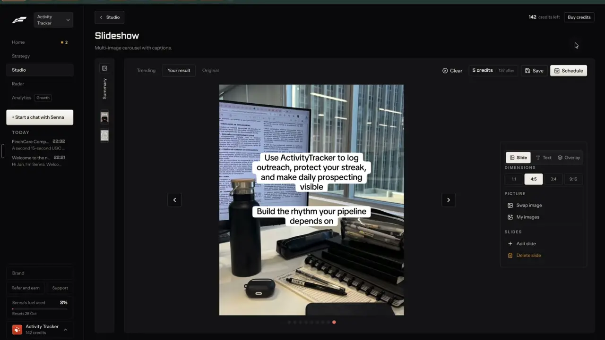

# In your brand, voice, face and offer

`remix-your-brand` | remix | phase 1 | status: partial | /north-star#remix-your-brand

## Leo asked

15 Oct 2026: "embed it within the tool so it depends on the person's market/website"

8 Oct 2026: "an all in one tool for my social media management, and for each person too"

## How the best do it

Fastlane puts the brand in by default and lets you take it out. The Slideshow remix page has a "MENTION ACTIVITY TRACKER" switch (the brand's name is part of the label) with "Yes" selected and the helper "Yes works Activity Tracker into the slides. No keeps it as pure value content." Under it sits "STEER IT (optional)" with the placeholder "What should this slideshow be about?" (2:37). Wall of Text, the other remix page in the recording, has the same switch (its helper says "into the text") and a "PROMPT (optional)" box, "What should the wall of text be about?" (3:24). The Yapper video format page, which is not a remix page, folds its other options into a "More settings" card with a summary line ("No details, no product, no brand name, English, captions Classic") and a "Show" button (1:32); it was never opened. The results lean on facts from the Brand profile: Leo's remixed slideshow ends on "Use ActivityTracker to log outreach, protect your streak, and make daily prospecting visible" (3:03), and an earlier remix named the streaks, the leaderboard and the virtual corgi.




Others:

- Atria clones a competitor ad into your brand from the reference ad, your website URL (it pulls imagery and copy) or product photos, and a saved brand profile with colours, fonts and messaging, and returns eight on-brand variants in seconds. Per-image cost is unverified, and one Trustpilot reviewer said a clone changed how the product looked. [best AI ad generators](https://www.tryatria.com/blog/best-ai-ad-generators), [tryatria.com](https://www.tryatria.com)
- Vamos: "Recreate this format" sends the format to chat with the user's brand and voice attached, keeping the beats and swapping in the user's topic; it needs a trial or paid plan. [reading a format](https://intercom.help/getvamos/en/articles/16934916-reading-a-format)
- Sandcastles writes three ways to adapt each outlier to your niche when the workspace Persona has a content description. Without one, the idea shows "Tell us what you make content about" and a "Describe your content" button. Pro and up. [ideas](https://help.sandcastles.ai/ideas), [persona](https://help.sandcastles.ai/persona)
- Tweet Hunter "Tweet Rewriter - powered by AI" (Grow and up) and ContentIn "Viral post library - rewrite what works, in your voice" (Growth plan) rewrite saved posts in the user's voice. [tweethunter.io](https://tweethunter.io/), [contentin.io](https://contentin.io/)
- Hypefury: "AI posts that sound like you", learned from your own posts. [hypefury.com](https://hypefury.com/)
- Gethookd Clone Ads pulls brand images and product details from the active brand profile; it starts on Pro per its home page, all plans per its generator page (conflict). [ai ad generator](https://www.gethookd.ai/ai-ad-generator)

## What we have today

- Your voice (/voice, src/lib/voiceProfile.ts, `content-studio-voice-<scoped uid>`, so one per brand): 3 to 5 past posts and a summary. Write and Clone a reel use it; Clone also sends the adviser's best posts (`voiceForClone`, `winnersFor` in src/lib/reelClone.ts).
- Brand kit (/brand, src/pages/BrandPage.tsx, `content-studio-carousel-brand-<scoped uid>`): name, handle, role, headshot `photo`, `logo`, colour, sign-off, DM links, up to 5 offers, emoji and hashtag policy, avoid words, posting times. `brandRulesLine` and `applyBrandRules` (src/lib/brandRules.ts) apply it in Write, Batch, the carousel's Tighten and video captions, and carousels and video end cards wear the colour, headshot and logo.
- Positioning (src/lib/positioning.ts) holds the one-liner, audience, topics and edge, and the coach profile (src/lib/coachProfile.ts) holds the origin story and the facts fair to share, read through `coachContext`.
- Brands: one account runs several (src/lib/profiles.ts, `scoped(userId)`), and /brands/new fills one from its website with brand-dna.
- Faces today: the AI video panel's "You speaking" (src/components/AiVideo.tsx) asks for a photo each time under "My photo" ("Use a photo of yourself, or of someone who agreed to it.") or makes an AI presenter from one of six LOOKS (src/lib/aiVideo.ts). Nothing is saved between runs, and no remix reaches it.
- Write's FactFlags (src/components/FactFlags.tsx, writing-judge mode "facts", Jev, cap `fact-check` 60) flags checkable facts about CPF, SRS, HDB, insurance rules and rates on any draft, a remixed one included. It does not look for invented claims about the adviser.
- What a remix gets today: buildRemixUrl asks Write to write "in my voice" for "my audience", and Write then applies the voice and brand rules. There is no switch to leave the brand out, no offer pick, no face, and the colours only arrive if the user later opens the carousel maker.

## Build

Build after remix-everywhere, inside its Remix sheet, so the `leoOnly` gate and the REMIX_USERS check cover it. A "For" row in the sheet sums up what the remix will wear and opens into the few switches that change it; the app remembers those switches per brand and sends one brand block with each `make`.

### Screens and states

Collapsed (default):

```
For   MoneyBees | your voice | mentions MoneyBees | no offer      [Change]
```

Expanded:

```
For   MoneyBees                                            [Done]
Mention MoneyBees   [Yes *] [No]
                    Yes works MoneyBees into the post. No keeps it as pure value content.
Offer               [None *] [Free retirement check] [Book a call]
Voice               Your voice (5 posts)                  or  No voice saved yet. [Add 3 posts]
Face                [My face *] [AI presenter]            (only with a video format)
Video voice         [My voice *] [Alice v]                (only with a video format)
Look                [swatch] [logo]  From Brand kit
```

- The summary line is built in code from the settings, for example "MoneyBees | your voice | mentions MoneyBees | no offer | your face". Its face part appears only with a video format.
- "Change" expands the row and "Done" collapses it; each switch saves at once (no Save button) and the summary updates in the same frame.
- Offer chips come from brand-products when it has shipped (`src/lib/products.ts`, items with "Use in posts" on), else from the brand kit's offers (`brandOffers` in src/lib/brandRules.ts, at most 5, MAX_OFFERS in src/lib/carousel.ts). With neither, the line reads "No offers yet." with "Add an offer" linking to `/brand#offers`.
- No usable voice (`isVoiceProfileUsable` false): "No voice saved yet." with "Add 3 posts" linking to `/voice`. The remix still runs in a plain first person, as Clone a reel does today.
- "My face" is the face saved by people-my-face (`src/lib/myFace.ts`, `content-studio-myface-<uid>`, status on). With no saved face the chip is disabled with "Save your face first" linking to `/people?tab=face&record=1` (the recorder, from people-my-face), and "AI presenter" is selected. Before people-my-face ships, the chip is not shown. The brand kit headshot is not used: BrandPage shrinks it to a 256 x 256 square (`shrinkImage` in src/pages/BrandPage.tsx), too small for Speak.
- "AI presenter" uses a presenter saved by people-presenters (`src/lib/presenters.ts`) when one exists, shown as a strip of small tiles to pick from; with none saved, the next video remix makes one with `makePresenter(look)` (src/lib/aiVideo.ts, Soul v2, cap `ai-image`). The result is labelled "AI presenter" wherever it shows.
- "My voice" is the voice saved by people-my-voice (`src/lib/myVoice.ts`) and is hidden until that ships; otherwise the seven premade voices are offered.
- Look is read-only: the colour swatch and the logo come from the brand kit, and the carousel maker and the video end card apply them as they do today.
- A brand switch in the profile switcher while the sheet is open reloads these settings for the new brand.

The steer prompt is the sheet's "Note (optional)" box from remix-everywhere. There is one box, and its text goes into the brand block below as the adviser's own instruction.

### Copy

| Where | String |
| --- | --- |
| Row label | "For" |
| Buttons | "Change", "Done" |
| Mention | "Mention <brand name>", "Yes", "No", helper "Yes works <brand name> into the post. No keeps it as pure value content." |
| Offer | "Offer", "None", each offer's name; empty "No offers yet." with "Add an offer" |
| Voice | "Voice", "Your voice (<n> posts)"; empty "No voice saved yet." with "Add 3 posts" |
| Face | "Face", "My face", "AI presenter", "Save your face first" |
| Video voice | "Video voice", "My voice", the seven premade names: Alice, Lily, George, Eric, Matilda, Sarah, Liam |
| Look | "Look", "From Brand kit" |
| Summary parts | "your voice" / "plain voice", "mentions <brand>" / "no brand mention", "no offer" / "<offer name>", "your face" / "AI presenter" |
| Warning chip on a result | "Says something about you that isn't in your profile. Check it." |

### Data

- New synced key `content-studio-remix-prefs-<scoped uid>`: `{ mention: boolean, offer: string | null, face: "mine" | "new" | <presenter id>, voice: "mine" | VoiceId }`, defaults `{ mention: true, offer: null, face: "mine", voice: "mine" }`, falling back to `face: "new"` without a saved face and to `voice: "alice"` without a saved voice. Helpers `loadRemixPrefs` and `saveRemixPrefs` in src/lib/remix.ts.
- The offer is stored by its name, or by the product id once brand-products ships; a renamed or deleted one falls back to null without an error.
- The saved face's photo is a 9:16 JPEG data URL, and `makeAvatar` sends any string it gets as `{ url }`, so the job turns the data URL into a Blob first (`await (await fetch(dataUrl)).blob()`). A saved presenter goes in the way people-presenters sends it: its Higgsfield https link as a string while the browser can still fetch it, else its saved JPEG copy as a Blob. None of this needs a schema change.

### AI and cost

- The `make` request carries one block, built by `brandPack(userId)` in src/lib/remix.ts:

```ts
brand: {
  name: string;            // brand kit name, else the profile name
  oneLiner: string;        // positioning.oneLiner
  audience: string;        // positioning audience and audienceDetail
  topics: string[];        // positioning.topics
  facts: string;           // coachContext(loadCoachProfile(...)), may be empty
  mention: boolean;
  offer: { name: string; brief?: string } | null;  // brief = productBrief(p) once brand-products ships; never the link
  rules: string;           // brandRulesLine(kit, platform)
}
voice: VoiceInput | null   // voiceForClone(profile, winnersFor(userId))
note?: string              // the sheet's note, at most 300 chars
```

- `supabase/functions/remix/logic.ts` adds a BRAND block to the prompt. With mention on: "Work <name> in once, where it is natural: who is speaking, or what to do next. Say nothing about <name> beyond the facts given." With mention off: "Do not name <name> or any product. This is pure value content." With an offer: "End by pointing to <offer name>. Do not state a price or promise a result." Always: "Use only the facts given about the adviser. Never invent a personal story, a client story, a number of clients or years of experience." The note goes last under "The adviser's own note", and never outranks the compliance block.
- After writing, the app runs `applyBrandRules` on every text field (emoji and hashtag policy, avoid words, allowed links) before saving, as Write does.
- One Jev question rides on the `make` call's single `askJev` (shared with remix-closeness): `invented_self`, a noul (Jev's yes/no type in supabase/functions/_shared/jev.ts): "Does `post` say something about the adviser, their clients or their results that is not in `facts`?" Warn with the chip above at 0.5 or more. Set the threshold from the first 50 remixes by reading every case between 0.3 and 0.7. Jev null means no chip.
- Cost: text formats get no new paid call, since the block only adds about 300 input tokens to `make` (under 0.1 US cent), and "AI presenter" adds one Soul v2 picture at about US$0.006 on the existing `ai-image` cap of 5, so this item needs no cap of its own.

### Deep links

`?remix=<key>&for=open` opens the sheet with this row expanded. `mention=no` and `offer=<slug of the offer name>` override the remembered settings for that remix only (the URL wins, then the remembered pick, then the default), so a job or the assistant can link "remix this without naming the brand". All three replace the history entry, and defaults are left out.

## Done when

- [ ] The collapsed row shows the right summary for a brand with and without a voice and offers, and as you or as the business.
- [ ] With mention on, the brand's name appears once in the result; with mention off it appears nowhere (checked with a plain text search on 5 remixes).
- [ ] Picking an offer ends the result on that offer, and its link appears only through the brand rules.
- [ ] A "You speaking" remix makes an AI presenter, labelled "AI presenter" in the For row and its summary, and speaks in the Video voice picked.
- [ ] A brand that isn't a person (ActivityTracker) writes as the business, with no "I" and no personal story, and the invented check asks about the business's claims.
- [ ] Settings differ per brand and come back after a reload and on another device.
- [ ] A result that claims "I've helped 300 families" with no such fact in the coach profile shows the warning chip.
- [ ] Build, full vitest, 390 px and 1440 px; northStar.ts flipped.

## Tests

- `src/lib/remix.test.ts`: `brandPack` reads the kit, positioning and coach profile for the active brand only (two brands, two different packs); `loadRemixPrefs` gives the defaults, falls back to a new presenter without a saved face, to "alice" without a saved voice and to no offer when the named offer is gone; the summary line matches each combination.
- `supabase/functions/remix/logic.test.ts`: mention on and off put the matching instruction in the prompt; the offer's name appears and its URL never does; the note sits under the compliance block.
- `supabase/functions/remix/logic.test.ts`: `invented_self` is asked with the facts in the state and its threshold is applied, with Jev null giving no chip.

## Open questions

- A product or offer catalogue richer than the kit's five named links belongs to brand-products, and the Offer line should read from it once it ships.
- Whether the brand kit's colours should also drive caption styles on remixed videos is left to brand-kit.
- 20 Oct 2026 (phase-1 build): the saved-face, saved-presenter and brand-products lines moved here from Done when, so this item can finish without them. "You speaking" uses the saved face once people-my-face ships ("My face" stays hidden until then), "AI presenter" picks a saved presenter once people-presenters ships (until then each video remix makes a new one), and the Offer line reads products once brand-products ships.
- 20 Oct 2026 (dogfood finding): the first live make for ActivityTracker came back as an adviser saying "I". The brand block now carries `speaker: 'person' | 'business'`: the account's own brand, or an added brand whose kit has a role or a headshot, is the person; any other added brand is the business, which writes as "we", its name or "you" and never claims a personal story. The For row's "Speaks" line changes it, kept in the remix prefs per brand. Whether the kit should get an explicit "This brand is a business" switch is Leo's call.

## Related

remix-everywhere, remix-any-format, remix-intent, remix-fit-check, brand-from-website, brand-kit, brand-products, brand-voice-memory, people-my-face, people-presenters, people-ai-labels
