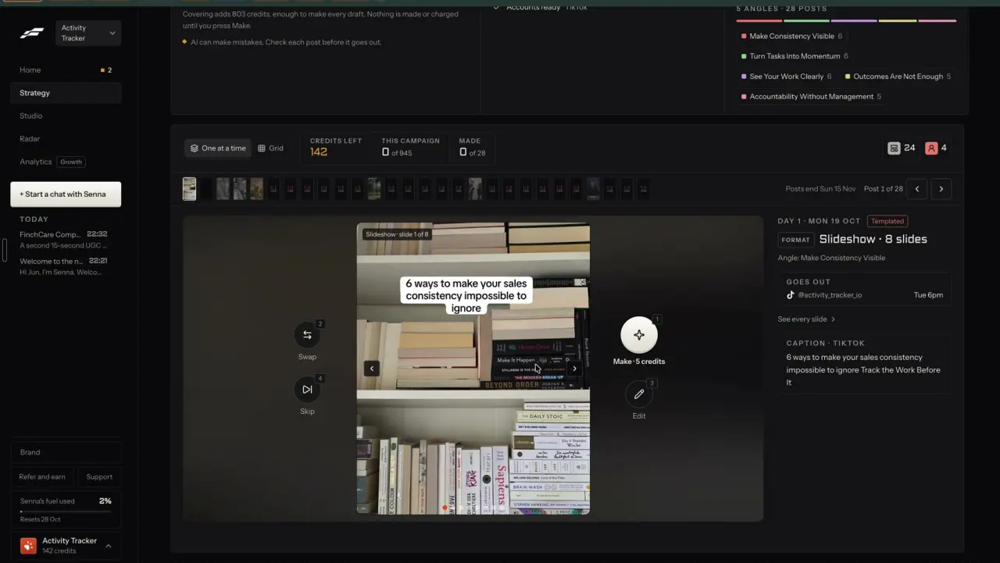

# MAS check on every post and video

`trust-compliance-check` | trust | phase 8 | status: partial | /north-star#trust-compliance-check

## Leo asked

No direct ask; from the competitor research. The north star needs it all the same: every remix ends as a post an adviser can publish in Singapore, so every remix output has to pass this check before it is approved.

## How the best do it

Fastlane has no compliance check. The nearest thing in Leo's recording is a grey line above the campaign's post reviewer, "AI can make mistakes. Check each post before it goes out." (top left of the frame below), and nothing in the app reads the words for the user.



The adviser-compliance tools set the bar:

- Hearsay Social (Yext) checks video before it goes out. A trained model scans the frames for bad imagery, and the auto transcript plus the body text, titles and caption files are checked against the firm's lexicon, with compliance staff making the final call. In 2021, 53% of its customers published 360,000+ videos. ([announcement](https://www.yext.com/about/news-media/hearsay-systems-offers-financial-industrys-first-ai-powered-video-compliance-pre-review-solution), [datasheet](https://info.yext.com/rs/906-IBA-353/images/Hearsay_Social_Datasheet_2022.pdf))
- Hearsay's supervision adds a Risk Meter and routing, so supervisors see the riskiest items first. It claims up to 80% less time spent reviewing. Enterprise only. ([compliance datasheet](https://info.yext.com/rs/906-IBA-353/images/Hearsay_Compliance_Datasheet_2022.pdf))
- Proofpoint Patrol runs 200+ classifier rules that mix AI, lexicons and regex; its compliance set has "Financial Promotions" and "Financial Testimonials". Each rule has its own action, "Delete", "Notify", "Delete and Review" or "None", and a severity. Any publishing tool can call it before posting, and the user gets "immediate feedback on policy violations with guidance to fix". Pricing is not published. ([data sheet](https://www.proofpoint.com/uk/resources/data-sheets/patrol))
- FMG Suite Overwatch flags "potentially risky language before submission" while the adviser drafts, and checks its own AI writer's output too. Risk scoring and one-click corrections were announced for later in 2025; whether they shipped is unverified. Firms opt in. ([AI tools](https://fmgsuite.com/features/ai-tools/), [announcement](https://fmgsuite.com/company/in-the-news/fmg-leads-the-way-in-ai-innovation-with-new-tools-to-help-advisors-market-more-efficiently-and-streamline-compliance/))
- OpusClip Auto Censor masks words from a list in captions and audio (beep, mute or leave). Custom lists are on Business and Enterprise only. For advisers the useful part is the custom list; Content Studio flags instead of beeping. ([help](https://help.opus.pro/docs/article/how-to-censor-curse-words.md), [pricing](https://www.opus.pro/pricing))
- Creatify runs a vision critic over each scene against the brief and remakes failing scenes, on by default in Pro mode. ([agent](https://creatify.ai/features/agent))
- Smarsh applies supervision policies with multi-tier review queues (from a search summary, unverified). ([social](https://www.smarsh.com/channels/social/))

What to copy: one check that every surface calls, per-rule actions a firm owns, a risk level that orders the work, the video's spoken words checked like text, and a fix offered on the line that broke the rule.

## What we have today

Checked against origin/main 08537d1.

- `src/lib/compliance.ts`: 8 fixed regex rules (`guarantee`, `risk-free`, `100-safe`, `best-superlative`, `aia-best`, `specific-return`, `easy-money`, `act-now`), each "warn" or "error". `scanCompliance(text)` returns flags and `hasComplianceErrors(flags)` says whether any is an error.
- Where the chips show: Write (`ComplianceChips` in `src/pages/GeneratePage.tsx`, debounced 500 ms, dismissable, plus each platform caption in `src/components/PlatformCaptions.tsx`), carousel slides (`src/pages/CarouselPage.tsx`, "No compliance flags in the slide text. Still read it through before you post."), the video editor's "Post caption" box only (`captionFlags` in `src/pages/VideoEditPage.tsx`), Clone a reel (`src/pages/CloneReelPage.tsx`, "No compliance flags. Still read it through before you post."), Idea Dump (`src/components/IdeaDump.tsx`), saved replies (`src/components/engage/Snippets.tsx`), Auto-DM and the recruit kit.
- An error flag blocks in two places: Post it for me (`"Fix the compliance error in the caption first."`, `src/components/PostItForMe.tsx`) and saving an Auto-DM (`src/pages/AutoDmPage.tsx`). Write only puts a "!" on Copy, and the header comment in `compliance.ts`, which says nothing blocks, is out of date.
- The video editor never checks what is said: the transcript (`transcript` memo in VideoEditPage, the words that survive the cuts), the hook card (`settings.hook`) and text stickers (`settings.overlays` of kind "text") all go unscanned. Cuts made by hand live in `settings.removed` as `{ s, e }` second ranges.
- "Watch it like a viewer" (video-assist watch, Gemini, cap `video-watch` 30, about US$0.07 a 40 s reel) already watches an export for what a viewer would trip on, with nothing about compliance in what it looks for.
- Jev already flags facts to check through writing-judge mode "facts" (`supabase/functions/writing-judge/logic.ts` `factQuestions`, a yes/no question per sentence, `FACT_MIN` 0.5, about 230 Jev tokens a sentence), shown by `src/components/FactFlags.tsx` (cached per `textKey`, `live={false}` in Write) under cap `fact-check` 60, and it flags without rewriting anything. The function refuses non-English text with 422 `not_english` and checks `TYPESAFE_API_KEY` before it spends a use. When Jev fails it answers 503 and keeps the use.
- The writers' prompts: `COMPLIANCE_LINES` in `supabase/functions/engage-assist/logic.ts`, the clone-reel prompt (`supabase/functions/clone-reel/logic.ts`) and idea-dump forbid promised returns, "guaranteed", named products and specific return figures. Write's own generator, generate-social-content, runs on the shared academy project (snapshot in `supabase/snapshots/functions/generate-social-content/index.ts`) and only says "No claims of guaranteed returns."
- Team review keeps the regex flags with each submission (`compliance_flags` in `cs_review_submissions`, SQL 011), so a leader sees them in the queue.
- Missing: a check that reads meaning (the regex misses "you will never lose a cent" and "8% a year, every year"), a risk level, one-tap fixes, the video's spoken words and on-screen text, and rules a team leader owns with warn, block or review.
- brand-rules (spec written) adds the adviser's own "Never say / Never talk about / Always include" rules with a Jev check. This item owns the fixed MAS set and the team's actions; the two share one panel.

## Build

Two phases. Phase A needs no schema change and ships behind `leoOnly(email)`. Phase B adds team-owned actions and needs a migration, so it stops for Leo first.

### Screens and states

One component, `src/components/MasCheck.tsx`, built like `FactFlags`: it checks a finished text by itself, and in an editor checks the first text then offers "Check again" after edits. Results are cached per text hash for the visit (`textKey("mas", text)` from `src/lib/postScore.ts`). It sits directly under the regex chips, which stay as they are, so the instant word check still shows with no network.

```
MAS check   Medium risk | 2 lines                           (i)
 [amber] Promises a result: "You'll retire with $1m if you start now."
         [Fix this line]  [Keep it]
 [amber] Pushes to act now: "Don't wait, prices go up next month."
         [Fix this line]  [Keep it]
                                                    [Check again]
```

States:

- Idle in an editor before the first check: nothing shown.
- Checking: a `ThinkingOrb` with `Checking each line...`.
- Clean: one grey line, `No compliance flags. Still read it through before you post.` (the Clone a reel string, reused).
- Hits: a header chip with the level and count, then one row per flagged sentence, worst first. Amber for Medium, red for High.
- Fixing a line: the row's button reads `Rewriting this line...` and is disabled.
- Fixed: the sentence is replaced in the editor's text and the toast `Line rewritten. Undo` shows. The check runs again on the new text.
- Fix failed: `Couldn't rewrite that line. Edit it by hand.`
- Kept: the row collapses to `Kept as written.` for this text. Kept rows still count toward the level shown to a leader.
- Not English (`mostlyEnglish` from `src/lib/humanCheck.ts` false, checked before any call; the server's 422 `not_english` lands here too): `The full check reads English only. The word check above still applies.`
- Over 40 sentences: the rows show as usual and one grey line adds `Checked the first 40 sentences.`
- Jev down or the function failed: `Couldn't run the full check just now. The word check above still applies.` with `Check again`.
- Over the daily cap: the server's 429 text, `You've used all 60 for today. It resets at 8am Singapore time.`
- Phase B blocked: Copy, Mark posted and Post it for me show the reason in the slot today's team rule uses: `Your team blocks this: <label>. Fix the line first.`
- Phase B review: `Your team needs this approved first: <label>. Submit it for review.` with the existing `Submit for review` button from `DraftReviewControl`.

Where it runs:

- Write: under `ComplianceChips`, on hook plus body. Anchor `#mas-check`.
- Carousel: on every slide title and body joined, beside the existing "No compliance flags in the slide text" line, before "Download all".
- Video editor: one check over three texts, labelled `What you say`, `On-screen text` (the hook card and text stickers) and `Caption`. It sits in the "Post caption" section, under the caption box. There is no Export panel: it runs once when that section has a transcript and the project opens, and again on `Check again`. Rows show which of the three each line came from. The `Fix this line` button shows only for on-screen text and caption; a spoken line gets `Cut this line` (it adds the sentence's first word start to last word end to `settings.removed`, the same as cutting it by hand in the Words tab) or `Keep it`.
- Clone a reel: on "Your version" script and caption.
- Post it for me: on the final caption, run when the panel opens. In phase A a High result adds a warning above Schedule and never blocks; regex errors keep blocking as today.
- Team review queue (`src/components/team/ReviewQueue.tsx`): the stored level chip on each submission so a leader can work the High ones first, plus a `Sort: riskiest first` toggle in phase B.
- Remix outputs: every remix item that makes a post (remix-any-format and the formats-* items) mounts `MasCheck` on its result. They add it when they ship; this item ships the component.

Phase B, on `/team` for leaders, a card `MAS rules for your team` with id `mas-rules`:

```
MAS rules for your team                                  (i)
 Promises a result            [Warn | Block | Review]
 Says it can't lose           [Warn | Block | Review]
 Names a product or insurer   [Warn | Block | Review]
 Says best or number one      [Warn | Block | Review]
 A return without a qualifier [Warn | Block | Review]
 Pushes to act now            [Warn | Block | Review]
```

Warn is selected for every row by default. A change saves on tap, shows `Saved` within 400 ms, and adds an event to the audit trail.

### Copy

- Heading `MAS check`. InfoTip: `Reads each line for promises, guarantees, named products and pressure.`
- Levels: `Low risk`, `Medium risk`, `High risk`. Count: `1 line` / `<n> lines`.
- Category labels: promise `Promises a result`, guarantee `Says it can't lose`, product `Names a product or insurer`, superlative `Says best or number one`, number `A return without a qualifier`, pressure `Pushes to act now`.
- Row: `<label>: "<sentence>"`. In the video editor the row starts with `What you say`, `On-screen text` or `Caption`.
- Buttons: `Fix this line`, `Cut this line`, `Keep it`, `Check again`, `Undo`.
- Status lines: `Checking each line...`, `Rewriting this line...`, `Line rewritten. Undo`, `Kept as written.`, `Couldn't rewrite that line. Edit it by hand.`, `The full check reads English only. The word check above still applies.`, `Couldn't run the full check just now. The word check above still applies.`, `Checked the first 40 sentences.`
- Server refusals (existing wording reused): `Nothing to check yet.`, `Checks read posts up to 5,000 characters.`, `This check reads English posts only.`
- Post it for me warning (phase A): `High risk: <label>. Read it again before you schedule.`
- Phase B: card title `MAS rules for your team`, InfoTip `Warn shows a flag. Block stops posting. Review sends it to you first.`, segment labels `Warn`, `Block`, `Review`, toast `Saved`, block reason `Your team blocks this: <label>. Fix the line first.`, review reason `Your team needs this approved first: <label>. Submit it for review.`, rules unread `Couldn't check your team's rules. Reload to try again.`, check unread `Couldn't run the MAS check. Check again, or submit it for review.`, audit event label `MAS rule changed`, detail `<label>: <action>`.

### Data

Phase A:

- No new storage. Results are cached in memory per text hash, as FactFlags does. "Keep it" lives in component state for the current text, as Write's dismissed chips do.
- When a member submits for review, the Jev hits ride in the existing `compliance_flags` array (`submitForReview` in `src/lib/teamReview.ts`): `{ ruleId: "mas:<category>", severity: "warn" | "error", message: <label>, match: <sentence, 200 chars> }`, severity "error" for High. No schema change, since the column is free jsonb.

Phase B (stop for Leo, a schema change):

- New migration `supabase/hub/0NN_team_mas_rules.sql` (the next free number; 025 when this was written). Table `cs_team_mas_rules (team_id uuid references cs_teams on delete cascade, category text check (category in ('promise','guarantee','product','superlative','number','pressure')), action text not null check (action in ('warn','block','review')), set_by uuid not null, set_by_name text not null, set_at timestamptz not null default now(), primary key (team_id, category))`.
- RLS as in 014: members of the team read their team's rows, no client writes. RPC `cs_set_mas_rule(p_category text, p_action text)`, SECURITY DEFINER, leaders only, writes the row and an event `mas_rule_set` in `cs_review_events` in the same transaction. The `cs_review_events.kind` check constraint gains `mas_rule_set`; `EVENT_LABEL` and the audit CSV `comment` column gain it too.
- A missing row means Warn. If the rules read errors, posting stays locked with `Couldn't check your team's rules. Reload to try again.`, the same fail-closed choice `memberRule` makes for the approval rule today.
- Under a Block or Review rule, a post the check could not read because Jev was down holds posting with `Couldn't run the MAS check. Check again, or submit it for review.` Non-English posts fall back to the word check alone, since Jev reads English only.
- Review routing reuses the team rule's lock: when a hit's action is Review, `postingBlockReason` treats the post as needing approval even if the member's `needs approval before posting` rule is off. The approval itself is the existing submission flow.

### AI and cost

- Decision: Jev, `jev-1.13.0`, new writing-judge mode `"mas"` added to `MODES`. Body `{ mode: "mas", text, source: "post" | "slides" | "video" | "caption" }`. The parser refuses text under 20 characters with `Nothing to check yet.` (the facts mode's line) and over `MAX_TEXT` (5,000) with the existing `Checks read posts up to 5,000 characters.`; sentences come from `splitSentences(text).slice(0, MAX_SENTENCES)` (40), and the reply carries `truncated: true` past 40. One Choice question (`type: "choice"` in `_shared/jev.ts`; read p(none) from `probabilities`) per sentence, ids `mas_<i>`:
  - instructions: `{ sentence, sentence_before, question: "Read as a public post by a Singapore financial adviser. Which of these does `sentence` do (read with `sentence_before` for context)?" }`
  - criteria:
    - `none`: "None of these. An opinion, a story, a question, general education, or a figure already marked as illustrated, projected or past."
    - `promise`: "Promises or implies a return, payout, profit or result the reader will get."
    - `guarantee`: "Says or implies something is guaranteed, risk-free, safe or cannot lose money."
    - `product`: "Names an insurer, a fund, an ETF, a stock, or a specific plan or product."
    - `superlative`: "Calls a plan, insurer or product the best, number one or top, without proof."
    - `number`: "Gives a specific return, rate, yield or percentage for a product or investment without saying it is illustrated, projected or past."
    - `pressure`: "Pushes the reader with urgency or fear to act now."
  - The categories copy `compliance.ts` and the writers' `COMPLIANCE_LINES`, so the check and the prompts ask for the same thing.
- Reading the answer (`readMas` in logic.ts): a sentence's risk is `1 - p(none)`. It is a hit at `MAS_MIN = 0.55` or more, labelled with its likeliest non-none category. The post is High when any hit is 0.8 or more or a regex error is present, Medium for a hit from 0.55 up to 0.8, else Low; mark both numbers `// shortcut: set from a side-by-side run, see Done when`.
- Fallback: Jev returns null, so the mode answers 503 with the existing `UNAVAILABLE` text and the client shows the Jev-down state. The regex chips never depend on Jev.
- Fix: the LLM writes the words. New mode `"mas-fix"` `{ sentence, category, text }` calls `openAiJson` (as the profile rewrites do) with: "Rewrite only this sentence so it no longer <criteria text>. Keep the meaning, the voice and the length. Add no number, product or claim that is not in the post. Reply as JSON {line}." Edge functions do not import from `src/`, so the client runs the returned line through `stripDashes` (`src/lib/plainText.ts`) and `scanCompliance`; a line that still trips a regex error is refused with the fix-failed state.
- Caps in `supabase/functions/_shared/usageCaps.ts`:
  - `"mas-check": 60`, comment "MAS check (writing-judge mode mas): one Jev call, about 400 tokens a sentence, about US$0.0003 a post."
  - `"mas-fix": 40`, comment "Fix this line (writing-judge mode mas-fix): one OpenAI call, about 400 tokens in and 60 out."
  - Refund with `refundUsage(admin, uid, feature, day)` from `usageCaps.ts`: `mas-fix` when OpenAI fails, and `mas-check` when Jev returns null and the mode answers 503, so a dead check never spends a use. The facts mode does not refund today; this mode does.
- Cost per run: the facts mode measured about 230 Jev input tokens a sentence with two criteria, and seven criteria will run longer, so budget about 400 a sentence at US$0.042 a million. A 15-sentence post then costs about US$0.00025. A fix is one short OpenAI call (`openAiJson` in `_shared/auditRunner.ts`, gpt-4.1), well under one US cent; measure the first 20 runs of each and correct the cap comments, while phase B calls no model at all.

### Deep links

- `/generate?draft=<id>#mas-check` scrolls Write to the check (`useScrollToHash`).
- `/edit?p=<project id>#mas-check` in the video editor. `panel` there means the start screen's join and AI panels, so it is not used; projects live on one device, so on another device the link opens the upload screen, as every `/edit?p=` link does.
- `/team#mas-rules` (phase B) scrolls to the rules card.
- Add the anchors to the /generate, /edit and /team rows in `docs/deep-links.md`.

## Done when

- [ ] Side-by-side run before anything shows: the regex and the Jev check over the last 200 real drafts and team submissions (Leo's two sign-ins plus `cs_review_submissions.content`), every disagreement read, `MAS_MIN` and the High line set from that run and the run's counts written in a comment beside them.
- [ ] On Leo's sign-in, Write shows the MAS check under the chips. "You'll retire with $1m if you start now." gets a Promises-a-result row, and a story about a client gets none.
- [ ] `Fix this line` replaces the sentence, `Undo` brings it back, and a rewrite that still says "guaranteed" is refused.
- [ ] The video editor's Post caption section checks the spoken words, the hook card, text stickers and the caption, labels the source of each row, and `Cut this line` adds the sentence's range to `settings.removed` so the preview skips it.
- [ ] A Jev failure on `mas` returns 503 and leaves the day's `mas-check` count where it was.
- [ ] Carousel, Clone a reel and Post it for me show the check; Post it for me warns on High and does not block on a Jev hit alone.
- [ ] With `TYPESAFE_API_KEY` unset on a local function, the check shows the Jev-down line, the regex chips still show, and no use is spent.
- [ ] The 61st check of the day shows the cap line.
- [ ] A member's submission carries `mas:<category>` flags and the leader's queue shows the level chip.
- [ ] Other sign-ins see today's chips and no MAS check.
- [ ] Phase B, after Leo approves the migration: a leader's Block on "Says it can't lose" disables Copy, Mark posted and Post it for me for a member whose post trips it, Review sends it to the queue, and each change is in the audit trail and its CSV.
- [ ] `npm run build` and the full `npx vitest run` pass; 390 px and 1440 px checked by eye; `src/data/northStar.ts` flipped in the same commit.

## Tests

- `supabase/functions/writing-judge/logic.test.ts`:
  - the mas body parser takes the four sources, refuses text under 20 characters and over 5,000 with the two existing lines, and marks `truncated` past 40 sentences;
  - `masQuestions` makes one Choice per sentence with all seven options and caps at 40;
  - `readMas`: risk 0.55 is a hit and 0.54 is not; the label is the likeliest non-none option; null answers give null;
  - `masLevel` returns High at 0.8, Medium at 0.55, Low below, and High whenever a regex error is passed in.
- mas-fix: the prompt carries the category's criteria text, and a reply that still trips `scanCompliance` with an error is refused.
- `src/lib/masCheck.test.ts`:
  - `toSubmittedFlags(hits)` maps to `mas:<category>` with "error" for High;
  - `videoCheckText({ transcript, hook, overlays, caption })` keeps the source of each sentence so rows can be labelled;
  - `cutForSentence(words, sentence)` returns `{ s, e }` from the first matching word's start to the last one's end, and null when the sentence is not in the transcript.
- Phase B, `src/lib/teamReview.test.ts`: `masBlockReason(hits, rules)` gives the block text for Block, the review text for Review and null for Warn or a missing rule; a rules read that failed gives the rules-unread line (fail closed, like `memberRule`), and a Block rule with no Jev result gives the check-unread line.
- `supabase/functions/_shared/usageCaps.test.ts`: `mas-check` is 60 and `mas-fix` is 40.
- Phase B SQL test `0NN_team_mas_rules.test.sql`, like 014's: a member cannot set a rule, a leader can, and each set writes one event.
- Prove each case bites by breaking the code once.

## Open questions

- Thresholds: `MAS_MIN` 0.55 and High at 0.8 are starting points until the side-by-side run sets them.
- Leo or a compliance adviser confirms the six categories, and whether to add personal advice (telling a reader to buy, switch or cancel a policy). It is left out because nothing in the repo asks for it yet.
- Whether a High result should block Post it for me for solo advisers. The recommendation says warn by default, so phase A only warns; regex errors keep blocking as today.
- Whether the check should run on a video's frames as well (Hearsay scans imagery). "Watch it like a viewer" already sends each export to Gemini under `video-watch`; adding a compliance question there would reuse that call, but it changes what a paid call does, so Leo decides.
- In phase B, Block and Review hold posting in the browser only. The server gate in trust-approval enforces the approval rule, and nothing on the server reruns the MAS check. Leo decides whether a Block needs a server check too.
- Write's generator (generate-social-content) lives on the shared academy project and its prompt bans only guaranteed returns. Bringing it up to the other writers' rules means changing a function another app shares, so Leo decides.
- Phase B is a schema change and waits for Leo.

## Related

brand-rules, trust-approval, trust-disclosures, trust-team-push, trust-approved-library, trust-archive, edit-score, people-ai-labels, remix-any-format, plan-review-queue, publish-schedule, edit-video
